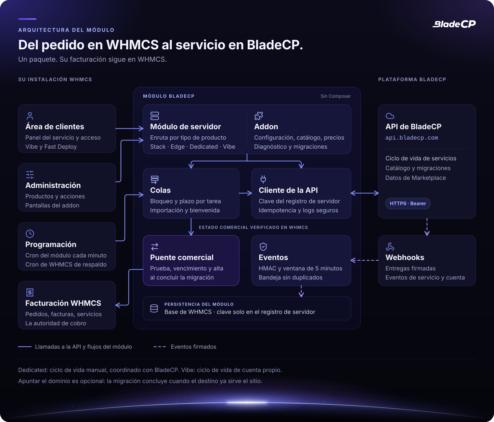
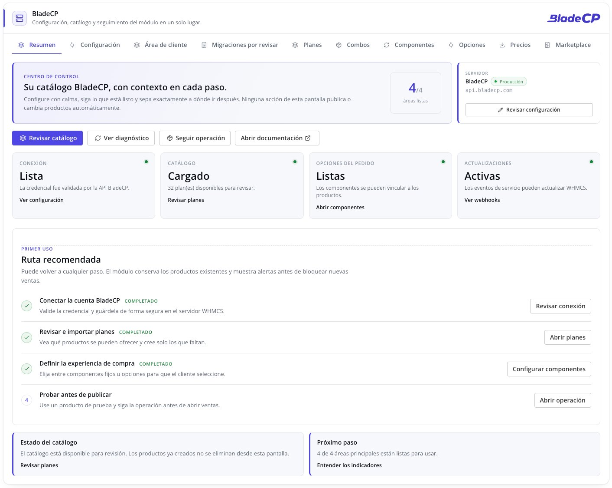
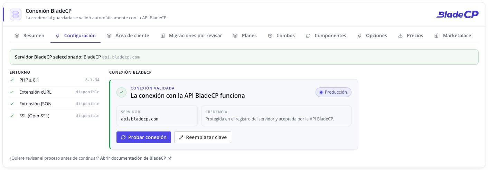
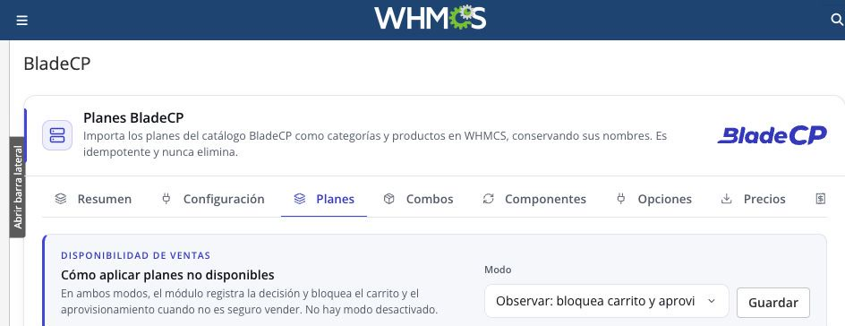
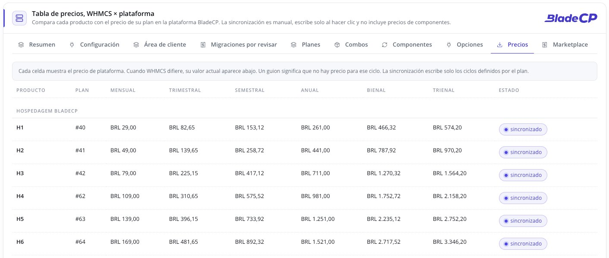
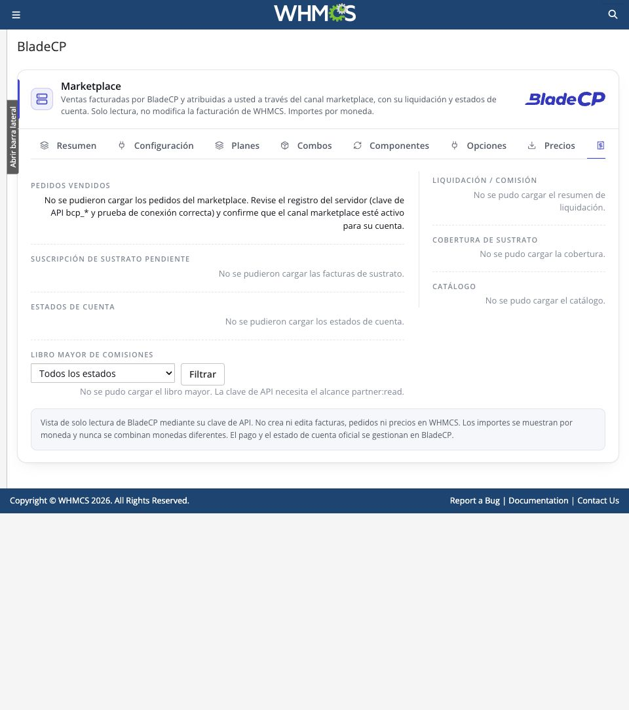
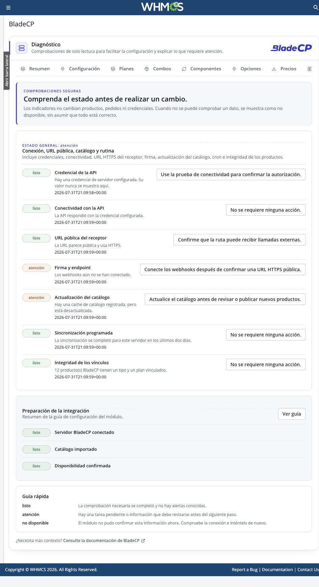
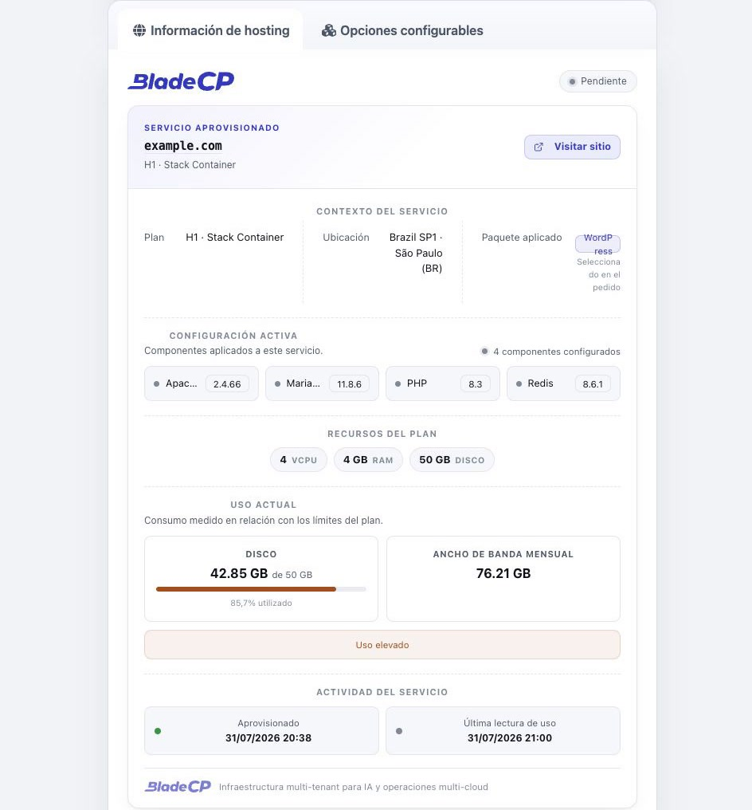

<p align="center">
  <picture>
    <source media="(max-width: 600px)" srcset="assets/hero-compact.es.svg">
    
  </picture>
</p>

<p align="center">
  <strong>Aprovisione y gestione servicios BladeCP directamente desde WHMCS.</strong><br>
  El módulo oficial de código abierto que conecta su WHMCS con la Customer API de BladeCP.
</p>

<p align="center">
  <a href="CHANGELOG.md"></a>
  <a href="#requisitos"></a>
  <a href="#requisitos"></a>
  <a href="#requisitos"></a><br>
  <a href="#calidad"></a>
  <a href="CHANGELOG.md"></a>
  <a href="LICENSE"></a>
  <a href="https://github.com/bladecp/bladecp-whmcs/actions/workflows/ci.yml"></a>
</p>

<p align="center">
  <a href="https://github.com/bladecp/bladecp-whmcs/releases/download/v0.9.0-rc.10/bladecp-whmcs-0.9.0-rc.10.zip"><strong>Descargar BladeCP para WHMCS (.zip)</strong></a>
  &nbsp;·&nbsp;
  <a href="https://github.com/bladecp/bladecp-whmcs/releases/tag/v0.9.0-rc.10">Notas de la versión</a>
  &nbsp;·&nbsp;
  <a href="https://github.com/bladecp/bladecp-whmcs/releases/download/v0.9.0-rc.10/SHA256SUMS">Suma de comprobación SHA-256</a>
</p>

<p align="center">
  <a href="#funcionalidades">Funcionalidades</a> ·
  <a href="#arquitectura">Arquitectura</a> ·
  <a href="#instalacion">Instalación</a> ·
  <a href="#configuracion">Configuración</a> ·
  <a href="#interfaz">Interfaz</a> ·
  <a href="#documentacion">Documentación</a> ·
  <a href="#seguridad">Seguridad</a> ·
  <a href="#soporte">Soporte</a>
  <br>
  <sub><a href="README.md">English</a> · <a href="README.pt-BR.md">Português (Brasil)</a></sub>
</p>

> [!IMPORTANT]
> **Versión candidata `0.9.0-rc.10`.** Esta versión preliminar es para
> validación de socios. Pruébela en un entorno WHMCS que no sea de producción
> antes de usarla con clientes.

BladeCP para WHMCS es el módulo oficial de aprovisionamiento de código abierto
para proveedores de hosting que venden servicios BladeCP desde su propia
instalación WHMCS. Conecta un registro de servidor WHMCS a la Customer API de
BladeCP, para que los pedidos y las acciones del servicio permanezcan en el
flujo de facturación habitual del proveedor.

El módulo ofrece soporte para productos **Stack Container**, **Edge Cloud (VPS)**,
**Dedicated** y **Vibe** elegibles en un único paquete instalable. Vibe usa un
ciclo de vida de cuenta propio, mientras el partner conserva la facturación del
cliente en WHMCS.

<a id="funcionalidades"></a>

## Creado para partners de BladeCP

| Un módulo | Control operativo | Administración opcional |
| --- | --- | --- |
| Dirija productos Stack, Edge, Dedicated y Vibe desde un único módulo WHMCS. | Cree, suspenda, reactive, cambie de plan, termine y abra el inicio de sesión único cuando la operación sea compatible con el producto seleccionado. | Active el addon complementario para configuración guiada, importación de catálogo, opciones configurables, webhooks y diagnósticos. |

### Productos y ciclo de vida

| Producto | Lo que hace el módulo | Alcance en esta versión candidata |
| --- | --- | --- |
| **Stack Container** | Creación, suspensión, reactivación, cambio de plan, cambio de contraseña, terminación, solicitudes de cancelación e inicio de sesión único | Ciclo de aprovisionamiento regular de WHMCS |
| **Edge Cloud (VPS)** | El mismo ciclo de vida que Stack Container | Ciclo de aprovisionamiento regular de WHMCS |
| **Dedicated** | Disponible mediante el mismo módulo y el mismo enrutamiento por tipo de producto | Ciclo de vida manual, coordinado con la operación de BladeCP |
| **Vibe** | Creación de cuenta, cambio de plan, suspensión, reactivación, terminación e inicio de sesión único | Solo planes elegibles, con ciclo de vida de cuenta propio y sin sincronización de uso de infraestructura |

Stack y Edge están diseñados para el ciclo de aprovisionamiento regular de
WHMCS. Los productos Dedicated están disponibles mediante el mismo módulo, pero
su aprovisionamiento y ciclo de vida pueden requerir gestión manual explícita
según el servicio ofrecido por la plataforma. Confirme las operaciones
disponibles para el plan que vende antes de activar flujos automatizados para
clientes.

### Aprovisionamiento y gestión de servicios

- Aprovisione servicios Stack, Edge, Dedicated y Vibe elegibles desde pedidos de WHMCS.
- Suspenda, reactive, cambie de plan y termine servicios mediante acciones estándar de WHMCS cuando la operación sea compatible con el producto seleccionado.
- Abra el panel de BladeCP con inicio de sesión único.
- Muestre un panel de servicio con la marca BladeCP en el área de clientes de WHMCS.
- Sincronice el uso del servicio para los flujos de facturación de WHMCS.
- Registre la intención de cancelación con las acciones **Cancelar ahora** y **Cancelar al final del ciclo**.
- Ofrezca acceso federado opcional a Vibe y una entrada de soporte restringida para operadores autorizados.

### Addon opcional de BladeCP

El aprovisionador funciona sin el addon. Cuando está activado, el addon añade
una interfaz de administración nativa de WHMCS para:

- Configuración guiada del servidor y validación de conexión.
- Importación idempotente del catálogo, de los planes BladeCP a los grupos y productos de WHMCS.
- Productos simples o configurables, combinaciones de componentes y sincronización de opciones configurables.
- Registro de webhooks, diagnósticos y una vista de solo lectura de la cuenta Marketplace.
- Opciones del área de clientes por servidor, como la tarjeta de prompt de Vibe y Fast Deploy.
- Revisión de migraciones, para elegir o crear el cliente de una migración que no se pudo cobrar automáticamente.

### Tareas programadas y migraciones

- **Un cron propio.** El addon ejecuta sus colas ligeras cada minuto y su
  sincronización diaria una vez al día. Cada tarea tiene su propio bloqueo,
  plazo y registro de errores, así que un fallo nunca detiene a las demás.
- **El cron de WHMCS como respaldo.** Si el cron del módulo se detiene, el cron
  de WHMCS hace un rescate limitado: las colas tras 15 minutos sin señal de
  vida y la sincronización diaria tras 36 horas sin éxito.
- **Sincronización diaria que preserva los precios.** Las opciones
  configurables, la disponibilidad del catálogo y el registro de webhooks se
  mantienen en orden sin modificar las filas de precios existentes.
- **Cobro del cPanel Migrator.** Las migraciones hechas por el cPanel Migrator
  con la clave de un servidor se convierten en servicios nativos de WHMCS, para
  que las cobre en WHMCS. El titular solo se reconoce a partir de un servicio
  cPanel que WHMCS ya tiene; los demás casos los confirma el titular de la
  cuenta o los decide un administrador.
- **Fast Deploy.** Un flujo opcional en el área de clientes para migrar desde
  una copia de seguridad completa de cPanel, con una política comercial para
  todos los planes del servidor: pagar antes de migrar, migrar y pagar para
  activar, o migrar y probar. Prueba, vencimiento y activación se aplican al
  concluir la migración.

## Explore la demostración en línea

Vea el módulo en un entorno WHMCS preparado: [whmcs-demo.bladecp.com](https://whmcs-demo.bladecp.com/).

Este entorno es solo para demostración. No introduzca información personal,
financiera ni credenciales reales.

## Arquitectura

El módulo separa la experiencia en WHMCS, el trabajo que se ejecuta con su
propia programación y la comunicación con BladeCP. WHMCS sigue siendo la
autoridad de facturación: cada transición comercial se vuelve a leer de sus
pedidos, facturas y servicios.

<p align="center">
  <picture>
    <source media="(max-width: 600px)" srcset="assets/architecture-compact.es.svg">
    
  </picture>
</p>

<p align="center"><sub>Vista lógica del módulo. <a href="assets/architecture.es.svg">Abrir el diagrama en tamaño real</a>.</sub></p>

### Del pedido al servicio

1. **WHMCS inicia el flujo.** Un pedido, una acción del administrador o el
   área de clientes llama al módulo de servidor, que enruta por el
   **BladeCP Product Type**.
2. **El cliente de la API habla con BladeCP.** Lee la clave del registro de
   servidor de WHMCS y llama a `api.bladecp.com` por HTTPS con una clave de
   idempotencia. Los registros del módulo se enmascaran antes de escribirse.
3. **Las tareas programadas continúan.** El cron del módulo ejecuta las colas
   cada minuto, cada una con su propio bloqueo y plazo. El cron de WHMCS solo
   interviene cuando el cron del módulo se detiene.
4. **Los eventos vuelven firmados.** Los webhooks se verifican, con firma y
   ventana contra repeticiones, antes de que una bandeja de entrada persistente
   los aplique al servicio vinculado, sin duplicados.
5. **La facturación se queda en WHMCS.** En las migraciones, el puente
   comercial aplica prueba, vencimiento y activación al servicio nativo al
   concluir la migración. Apuntar el dominio es opcional.

| Capa | Responsabilidad |
| --- | --- |
| **Módulo de servidor** | Callbacks de WHMCS, enrutamiento por tipo de producto, panel del servicio en el área de clientes e inicio de sesión único |
| **Addon** (opcional) | Configuración, catálogo, precios, opciones del área de clientes, diagnóstico y revisión de migraciones |
| **Colas y cron del módulo** | Cierre del acceso federado, bienvenida de Vibe, importación del cobro del cPanel Migrator y puente comercial |
| **Cliente de la API** | Credencial del registro de servidor, idempotencia, registros enmascarados y lecturas en paralelo |
| **Eventos** | Verificación de firma, ventana contra repeticiones y bandeja de entrada persistente sin duplicados |
| **Persistencia** | Tablas en la base de datos de WHMCS, con la clave de API solo en el registro de servidor |

<a id="descargas"></a>

## Descargas y notas de la versión

**`0.9.0-rc.10`** es la versión candidata actual. Limita el paquete al entorno
de producción de BladeCP, documenta el cron del módulo como requisito de
programación y lleva el control público de higiene a reglas genéricas, según el
[changelog](CHANGELOG.md). Cada versión
publicada ofrece el ZIP instalable y su suma de comprobación SHA-256. Revise
las notas de la versión antes de actualizar.

| Archivo | Finalidad |
| --- | --- |
| [**bladecp-whmcs-0.9.0-rc.10.zip**](https://github.com/bladecp/bladecp-whmcs/releases/download/v0.9.0-rc.10/bladecp-whmcs-0.9.0-rc.10.zip) | Paquete instalable, que contiene solamente `modules/` |
| [**SHA256SUMS**](https://github.com/bladecp/bladecp-whmcs/releases/download/v0.9.0-rc.10/SHA256SUMS) | Suma de comprobación para verificar la integridad del ZIP |
| [**RELEASE_NOTES.md**](https://github.com/bladecp/bladecp-whmcs/releases/download/v0.9.0-rc.10/RELEASE_NOTES.md) | Notas que acompañan este paquete |

Consulte la [página de esta versión](https://github.com/bladecp/bladecp-whmcs/releases/tag/v0.9.0-rc.10)
o [todas las versiones de BladeCP para WHMCS](https://github.com/bladecp/bladecp-whmcs/releases).
Los archivos automáticos **Source code** de GitHub contienen el repositorio;
para instalar el módulo, use el ZIP indicado en la tabla.

<a id="requisitos"></a>

## Requisitos y compatibilidad

| Componente | Requisito o base compatible |
| --- | --- |
| WHMCS | 8.x y 9.x. |
| PHP | 8.1 o posterior. |
| Base de datos | Cualquier motor y versión de base de datos compatible con la versión instalada de WHMCS. El módulo no añade ningún requisito específico de base de datos. |
| Temas de WHMCS | Temas que preserven los hooks y el marcado estándar de WHMCS. |
| Navegador | Navegadores modernos compatibles con WHMCS. El módulo no tiene ninguna dependencia específica de navegador. |
| Idiomas | Módulo orientado al cliente y administración del addon: inglés, portugués (Brasil) y español. |
| Dependencias de tiempo de ejecución | Extensiones de PHP cURL, JSON y OpenSSL |

El rango compatible sigue siendo WHMCS 8.x y 9.x con PHP 8.1 o posterior. La
última matriz completa de validación se hizo en `0.9.0-rc.4`, con WHMCS 8.13.3
y 9.0.6, PHP 8.2.31, MariaDB 12.3.2, la administración Blend y los temas de
cliente Twenty-One, Six y Nexus. Son entornos validados, no requisitos mínimos
adicionales. Las versiones candidatas de la línea 0.9.0 funcionan en
instalaciones WHMCS de producción de partners. Pruebe la versión en una
instalación WHMCS no
productiva antes de ponerla a disposición de sus clientes.

También necesita:

- Acceso administrativo a una instalación WHMCS compatible.
- Una cuenta de socio de BladeCP.
- Una clave de la Customer API de BladeCP.
- PHP con las extensiones cURL, JSON y OpenSSL activadas.
- Acceso HTTPS saliente a `api.bladecp.com`.
- El cron del módulo, ejecutado cada minuto por el crontab del servidor, para las colas y la sincronización diaria del módulo. Vea [Cron del módulo](docs/configuration.md#module-cron) (en inglés).
- El cron estándar de WHMCS, para la automatización de facturación y la actualización nativa de uso de WHMCS. También rescata las tareas del módulo si el cron del módulo se detiene.
- Un endpoint HTTPS público si activa webhooks entrantes.

<a id="instalacion"></a>

## Instalación rápida

Instale desde una [GitHub Release](https://github.com/bladecp/bladecp-whmcs/releases),
no desde una instantánea del código fuente. El servidor WHMCS no necesita
Composer ni una etapa de compilación.

1. Descargue el ZIP de la versión y el archivo `SHA256SUMS` correspondiente.
2. Verifique el artefacto desde el directorio que contiene ambos archivos:

   ```bash
   shasum -a 256 -c SHA256SUMS
   ```

   En Linux, puede ejecutar en su lugar:

   ```bash
   sha256sum -c SHA256SUMS
   ```

3. Haga una copia de seguridad de los archivos y la base de datos de WHMCS antes de instalar o actualizar el módulo.
4. Extraiga el ZIP en la raíz de su instalación WHMCS. Al finalizar, deben existir estos directorios:

   ```text
   modules/servers/bladecp/
   modules/addons/bladecp/
   ```

   El ZIP instalable contiene solamente `modules/`. No sobrescribe el README,
   la licencia ni los archivos de documentación de la raíz de WHMCS.

5. En WHMCS, cree o seleccione un servidor en **System Settings → Products/Services → Servers**.
6. Configure la conexión con BladeCP y ejecute **Test Connection** antes de asignar el módulo a un producto.
7. Para usar la configuración guiada, herramientas de catálogo, opciones configurables o webhooks, active **BladeCP** en **System Settings → Addon Modules**.
8. Añada el cron del módulo al crontab del usuario que ejecuta el PHP de WHMCS y mantenga también el cron de WHMCS:

   ```text
   * * * * * php -q '/ruta/a/whmcs/modules/addons/bladecp/cron.php'
   ```

   La pestaña **Diagnóstico** del addon muestra el comando exacto para su servidor.

Consulte la [guía detallada de instalación](docs/installation.md) (en inglés) para conocer el procedimiento completo.

### Actualización

Para actualizar, verifique el checksum de la versión y haga primero una copia
de seguridad de los archivos y la base de datos de WHMCS. Extraiga el nuevo ZIP
sobre la raíz existente de WHMCS. No elimine antes los directorios
`modules/servers/bladecp/` ni `modules/addons/bladecp/`. Sus registros de
servidor, productos y ajustes del módulo se conservarán en WHMCS. Consulte la
[guía detallada de instalación](docs/installation.md) (en inglés) para conocer
el procedimiento completo de actualización.

<a id="configuracion"></a>

## Configuración

### Recomendado: configuración guiada

Active el addon de BladeCP, abra el flujo **Quick Setup**, introduzca la clave
de Customer API y valide la conexión. El asistente crea el registro de
servidor BladeCP mediante los campos estándar de WHMCS.

### Configuración manual del servidor

Cree un servidor WHMCS con estos valores:

| Campo | Valor |
| --- | --- |
| Módulo | `bladecp` |
| Hostname | `api.bladecp.com` |
| Secure | Activado |
| Access Hash | Su clave de Customer API de BladeCP |

La clave de API debe almacenarse en el campo **Access Hash** del registro de
servidor en WHMCS. El addon opcional no requiere una segunda copia de esta
credencial.

A continuación, cree un producto WHMCS, seleccione el módulo `bladecp` y elija
**BladeCP Product Type** y **BladeCP Plan**. El addon puede importar entradas
de catálogo y sincronizar opciones configurables orientadas al cliente cuando
ese flujo se adapte a su tienda.

> [!WARNING]
> Defina el hostname explícitamente. Un hostname vacío utiliza el endpoint de producción.

La [guía de configuración](docs/configuration.md) (en inglés) cubre los
servicios Dedicated, Vibe, la tarjeta opcional de prompt de Vibe, el acceso
federado, los webhooks y el cron del módulo.

<a id="interfaz"></a>

## Vea el módulo en WHMCS

<p align="center">
  
</p>

| Configuración | Planes y catálogo |
| --- | --- |
|  |  |

| Precios | Marketplace |
| --- | --- |
|  |  |

| Operación y diagnóstico | Servicio contratado en el área de clientes |
| --- | --- |
|  |  |

Las capturas muestran el módulo empaquetado en un WHMCS de demostración, con
datos neutros como `example.com`. La apariencia final también depende del tema
y de la versión de su WHMCS.

<a id="documentacion"></a>

## Documentación

Las guías detalladas están en inglés.

| Guía | Qué encontrará |
| --- | --- |
| [Instalación](docs/installation.md) | Descarga, checksum, extracción y actualización |
| [Configuración](docs/configuration.md) | Registro de servidor, productos, Dedicated, Vibe, webhooks y cron |
| [Compatibilidad](docs/compatibility.md) | Requisitos, bases compatibles e instantánea de validación |
| [Solución de problemas](docs/troubleshooting.md) | Comprobaciones de conexión, catálogo, webhooks y Vibe |
| [Proceso de release](docs/release-process.md) | Cómo se preparan y verifican las versiones públicas |
| [Gobernanza del repositorio](docs/repository-governance.md) | Issues, pull requests, historial y versiones |
| [Changelog](CHANGELOG.md) | Cambios de cada versión pública |
| [Política de seguridad](SECURITY.md) | Informe privado de vulnerabilidades |
| [Contribución](CONTRIBUTING.md) | Cómo proponer y validar un cambio |

## Seguridad

- **Un solo lugar para la credencial.** Almacene la clave de Customer API
  únicamente en el registro de servidor de WHMCS. El addon no guarda ninguna
  copia.
- **Webhooks verificados.** Los webhooks entrantes verifican sus firmas, dentro
  de una ventana de cinco minutos contra repeticiones, antes de aplicar una
  actualización de servicio. Una bandeja de entrada persistente descarta los
  duplicados.
- **Registros enmascarados.** Los registros del módulo eliminan claves de API y
  campos sensibles antes de escribirse. Aun así, trate las claves de API, los
  secretos de firma de webhooks y los registros del módulo como datos
  operativos sensibles.
- **Bloqueo por defecto donde importa.** La escritura de credenciales, la
  verificación CSRF, la selección de servidor, la elegibilidad de venta, la
  verificación de webhooks y las transiciones de identidad de Vibe se detienen
  cuando no se pueden confirmar.
- **Siempre al día.** Mantenga WHMCS, PHP y este módulo actualizados con la
  versión que haya validado.

Para informar una vulnerabilidad de forma privada, siga [SECURITY.md](SECURITY.md).
No incluya credenciales, payloads de webhook ni datos de clientes en una issue
pública.

<a id="calidad"></a>

## Calidad y validación

La versión candidata `0.9.0-rc.10` fue validada por los mantenedores con
**1092 verificaciones automatizadas**: 732 verificaciones deterministas de
mapeo, enrutamiento, controles de venta, enmascaramiento de secretos, catálogo,
webhooks y flujos de Vibe, y 360 verificaciones de integración que ejercitan
hooks, actualizaciones de esquema, configuración cifrada, el transporte cURL y
el endpoint público de webhooks en un entorno WHMCS simulado, con PHP 8.2. La
insignia de pruebas representa esa ejecución.

Antes de montar el paquete, todos los archivos PHP pasan una verificación de
sintaxis y el árbol público se analiza en busca de credenciales y referencias
no públicas. El proceso de release también exige validar el ZIP por separado
en una instalación WHMCS desechable antes de publicarlo.

Este repositorio incluye sus propias verificaciones de regresión
(`tests/run.php`) y el control de estructura e higiene
(`scripts/check-public-tree.sh`). El
[CI público](https://github.com/bladecp/bladecp-whmcs/actions/workflows/ci.yml)
ejecuta ambos con PHP 8.1 y 8.2. Las verificaciones automatizadas no sustituyen
la validación en su propio WHMCS antes de atender a clientes.

<a id="desarrollo"></a>

## Desarrollo y contribución

WHMCS carga `modules/` directamente: no hay etapa de compilación ni
dependencia de Composer. Use PHP 8.1 o posterior; se recomienda PHP 8.2.

```sh
git clone https://github.com/bladecp/bladecp-whmcs.git
cd bladecp-whmcs
find modules tests -name '*.php' -print0 | xargs -0 -n1 php -l
php tests/run.php
bash scripts/check-public-tree.sh
```

```text
modules/
  servers/bladecp/    Módulo de servidor: callbacks, enrutamiento, cliente de la API, área de clientes
  addons/bladecp/     Addon opcional: configuración, catálogo, cron, webhooks, diagnóstico
tests/run.php         Verificaciones públicas de regresión
scripts/              Control público de estructura e higiene
docs/                 Guías de instalación, configuración y operación
assets/               Arte del README y capturas por idioma
```

Las contribuciones son bienvenidas. Lea [CONTRIBUTING.md](CONTRIBUTING.md)
antes de abrir una issue o pull request, mantenga los cambios enfocados, añada
cobertura relevante y no incluya nunca credenciales ni datos de clientes en un
commit. Las contribuciones aprobadas siguen el flujo de mantenimiento del
proyecto antes de aparecer en una versión pública posterior.

<a id="preguntas"></a>

## Preguntas frecuentes

<details>
<summary><strong>¿Necesito Composer o una etapa de compilación en el servidor WHMCS?</strong></summary>

No. El ZIP contiene `modules/` con un autoloader nativo. Extráigalo en la raíz
de WHMCS y el módulo queda listo para configurar.

</details>

<details>
<summary><strong>¿Dónde va la clave de API?</strong></summary>

En el campo **Access Hash** del registro de servidor de WHMCS. La configuración
guiada la guarda allí por usted. El addon opcional nunca necesita una segunda
copia.

</details>

<details>
<summary><strong>¿El addon es obligatorio?</strong></summary>

No. El aprovisionamiento básico funciona solo con el módulo de servidor. La
configuración guiada, la importación de catálogo, las opciones configurables,
los webhooks, el diagnóstico, la activación de Vibe y el cobro de migraciones
requieren el addon.

</details>

<details>
<summary><strong>¿Basta con el cron de WHMCS?</strong></summary>

No. Añada el cron del módulo cada minuto: ejecuta las colas y la
sincronización diaria del módulo. Mantenga el cron de WHMCS para la
automatización de facturación y la actualización nativa de uso. Si el cron del
módulo se detiene, el cron de WHMCS rescata las colas tras 15 minutos y la
sincronización diaria tras 36 horas.

</details>

<details>
<summary><strong>¿La migración espera a que se apunte el dominio?</strong></summary>

No. La migración se considera concluida cuando el destino ya sirve el sitio.
Prueba, vencimiento y activación siguen a partir de ahí; apuntar el dominio es
opcional.

</details>

<details>
<summary><strong>¿Puedo probarlo antes de instalarlo?</strong></summary>

Sí. La [demostración en línea](https://whmcs-demo.bladecp.com/) muestra el
módulo en un entorno WHMCS preparado. No introduzca datos reales en ella.

</details>

## Soporte

| Asunto | Canal |
| --- | --- |
| Bug reproducible o solicitud de producto | [GitHub Issues](https://github.com/bladecp/bladecp-whmcs/issues) |
| Soporte técnico y de producto | [dev@bladecp.com](mailto:dev@bladecp.com) |
| Vulnerabilidad | [Política de seguridad](SECURITY.md) |
| Demostración en línea | [whmcs-demo.bladecp.com](https://whmcs-demo.bladecp.com/) |

En los informes públicos, use datos neutros. Las credenciales, la información
de clientes y los payloads de webhook deben quedarse en canales privados.

## Licencia

BladeCP para WHMCS se distribuye bajo la [Licencia MIT](LICENSE). La licencia
del módulo no sustituye la licencia de WHMCS ni las condiciones de los
servicios BladeCP.

<p align="center"><strong>BladeCP. Su tienda, nuestra infraestructura.</strong></p>
