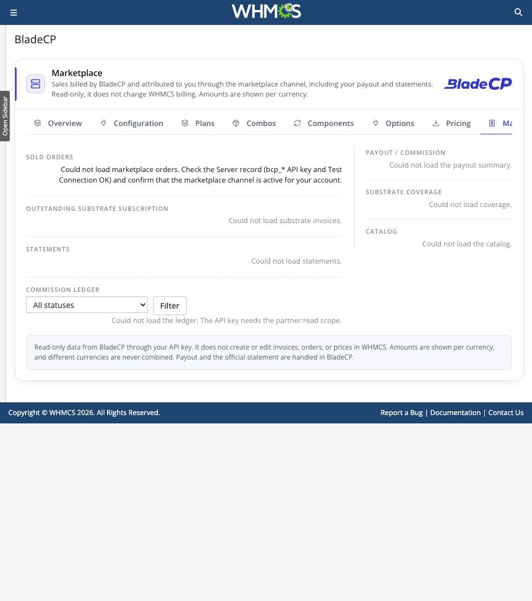
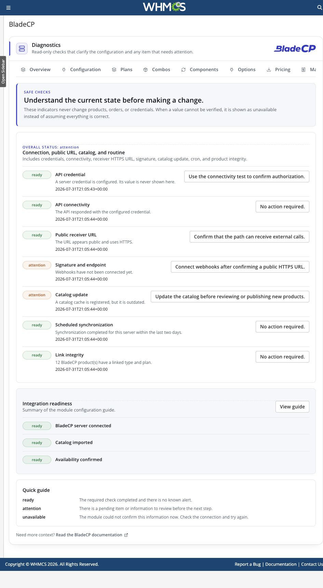
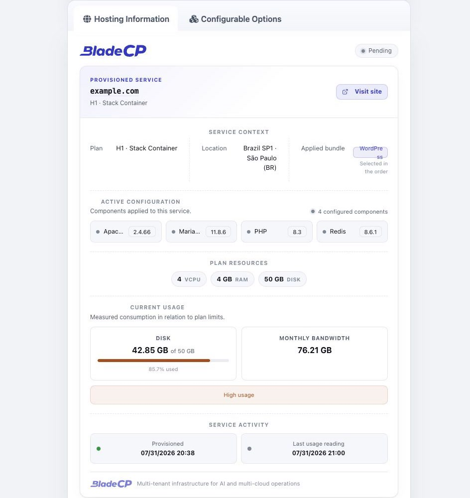

<div align="center">

<picture>
  <source media="(prefers-color-scheme: dark)" srcset="assets/logo-dark.svg">
  <source media="(prefers-color-scheme: light)" srcset="assets/logo-light.svg">
  
</picture>

# BladeCP for WHMCS

**Provision and manage BladeCP services directly from WHMCS.**

Release candidate: **0.9.0-rc.4**

[](https://github.com/bladecp/bladecp-whmcs/releases)
[](LICENSE)


[Download the latest release](https://github.com/bladecp/bladecp-whmcs/releases) · [Install](#installation) · [Configure](#configuration) · [Security](#security) · [Release process](docs/release-process.md) · [Português (Brasil)](README.pt-BR.md) · [Español](README.es.md)

[](https://github.com/bladecp/bladecp-whmcs/actions/workflows/ci.yml)

</div>

## Built for BladeCP partners

BladeCP for WHMCS is the official open-source provisioning module for hosting providers that sell BladeCP services from their own WHMCS installation. It connects a WHMCS server record to the BladeCP Customer API, so orders and service actions remain part of the provider's existing billing workflow.

The module supports **Stack Container**, **Edge Cloud (VPS)** and **Dedicated** products through one installable package. Dedicated services use an explicit manual lifecycle where the platform requires it. Vibe is intentionally not provisioned by this module.

## At a glance

| One module | Operational control | Optional administration |
| --- | --- | --- |
| Route Stack, Edge and Dedicated products from a single WHMCS module. | Create, suspend, unsuspend, change package, terminate and open single sign-on where supported by the selected product. | Activate the companion addon for guided setup, catalog import, configurable options, webhooks and diagnostics. |

## Explore the live demo

See the module in a prepared WHMCS environment: [whmcs-demo.bladecp.com](https://whmcs-demo.bladecp.com/).

This environment is for demonstration only. Do not enter real personal,
financial or credential information.

## See it in WHMCS

<p align="center">
  
</p>

| Configuration | Plans and catalog |
| --- | --- |
|  |  |

| Pricing | Marketplace |
| --- | --- |
|  |  |

| Operations and diagnostics | Contracted service in the client area |
| --- | --- |
|  |  |

## Features

### Provisioning and service management

- Provision eligible Stack, Edge and Dedicated services from WHMCS orders.
- Suspend, unsuspend, change package and terminate services through standard WHMCS actions where the selected product supports the operation.
- Open the BladeCP panel with single sign-on.
- Display a branded service panel in the WHMCS client area.
- Synchronize service usage for WHMCS billing workflows.
- Record cancellation intent with **Cancel now** and **Cancel at cycle end** actions.

### Optional BladeCP addon

The provisioner works without the addon. When enabled, the addon adds a WHMCS-native administration surface for:

- Guided server setup and connection validation.
- Idempotent catalog import, from BladeCP plans to WHMCS product groups and products.
- Simple or composable product choices, component combinations and configurable-option synchronization.
- Webhook registration, diagnostics and a read-only marketplace account view.

## Compatibility

| Component | Requirement or supported baseline |
| --- | --- |
| WHMCS | 8.x and 9.x. Validated with 8.13.3 and 9.0.6. |
| PHP | 8.1 or newer. |
| Database | Any database engine and version supported by the installed WHMCS release. The module adds no database-specific requirement. |
| WHMCS themes | Themes that preserve standard WHMCS hooks and markup. Validated with Blend administration and Twenty-One, Six and Nexus client themes. |
| Browser | Current evergreen browsers supported by WHMCS. The module has no browser-specific dependency. |
| Languages | Client-facing module and addon administration: English, Portuguese (Brazil) and Spanish. |
| Runtime dependencies | PHP cURL, JSON and OpenSSL extensions |

The validation snapshot for this release candidate includes WHMCS 8.13.3 and
9.0.6, PHP 8.2.31 and MariaDB 12.3.2. These are tested environments, not
additional minimum requirements. Test the release in a non-production WHMCS
installation before making it available to customers.

## Requirements

- Administrative access to a compatible WHMCS installation.
- A BladeCP partner account.
- A BladeCP Customer API key.
- PHP with the cURL extension enabled.
- A public HTTPS endpoint if you enable incoming webhooks.

## Installation

Install from a [GitHub Release](https://github.com/bladecp/bladecp-whmcs/releases), not from a source snapshot.

1. Download the release ZIP and its accompanying `SHA256SUMS` file.
2. Verify the artifact from the directory that contains both files:

   ```bash
   shasum -a 256 -c SHA256SUMS
   ```

3. Extract the ZIP into the root of your WHMCS installation. After extraction, these directories must exist:

   ```text
   modules/servers/bladecp/
   modules/addons/bladecp/
   ```

   The installable ZIP contains only `modules/`. It does not overwrite a
   WHMCS root README, license or documentation file.

4. In WHMCS, create or select a server under **System Settings → Products/Services → Servers**.
5. Configure the BladeCP connection, then run **Test Connection** before assigning the module to a product.
6. To use guided setup, catalog tools, configurable options or webhooks, activate **BladeCP** under **System Settings → Addon Modules**.

## Configuration

### Recommended: guided setup

Activate the BladeCP addon, open its **Quick Setup** flow, enter the Customer API key and validate the connection. The wizard creates the BladeCP server record using the standard WHMCS fields.

### Manual server setup

Create a WHMCS server with these values:

| Field | Value |
| --- | --- |
| Module | `bladecp` |
| Hostname | `api.bladecp.com` |
| Secure | Enabled |
| Access Hash | Your BladeCP Customer API key |

The API key belongs in the WHMCS server record's **Access Hash** field. The optional addon does not require a second copy of that credential.

Next, create a WHMCS product, select the `bladecp` module and choose its **BladeCP Product Type** and **BladeCP Plan**. The addon can import catalog entries and synchronize customer-facing configurable options when that workflow fits your store.

> [!WARNING]
> Set the hostname explicitly. An empty hostname uses the production API endpoint.

## Product lifecycle notes

Stack and Edge are designed for the regular WHMCS provisioning lifecycle. Dedicated products are available through the same module, but their provisioning and lifecycle can require explicit manual handling according to the service offered by the platform. Confirm the available operations for the plan you sell before enabling automated customer flows.

## Security

- Store the Customer API key only in the WHMCS server record.
- Treat API keys, webhook signing secrets and module logs as sensitive operational data.
- Incoming webhooks verify their signatures before applying a service update.
- Keep WHMCS, PHP and this module up to date with the release you have verified.

To report a vulnerability privately, follow [SECURITY.md](SECURITY.md). Please do not include credentials, webhook payloads or customer data in a public issue.

## Releases and support

Every published release provides the installable ZIP and its SHA-256 checksum. Review the release notes before upgrading: [BladeCP for WHMCS releases](https://github.com/bladecp/bladecp-whmcs/releases).

- Technical and product support: [dev@bladecp.com](mailto:dev@bladecp.com)
- Bugs and product requests: [GitHub Issues](https://github.com/bladecp/bladecp-whmcs/issues)

## Contributing

Contributions are welcome. Read [CONTRIBUTING.md](CONTRIBUTING.md) before
opening an issue or pull request, keep changes focused, add relevant coverage,
and never commit credentials or customer data. The private Bitbucket repository
is the primary development source; approved GitHub contributions are imported
there before they return in a later curated public export.

## License

BladeCP for WHMCS is released under the [MIT License](LICENSE).
