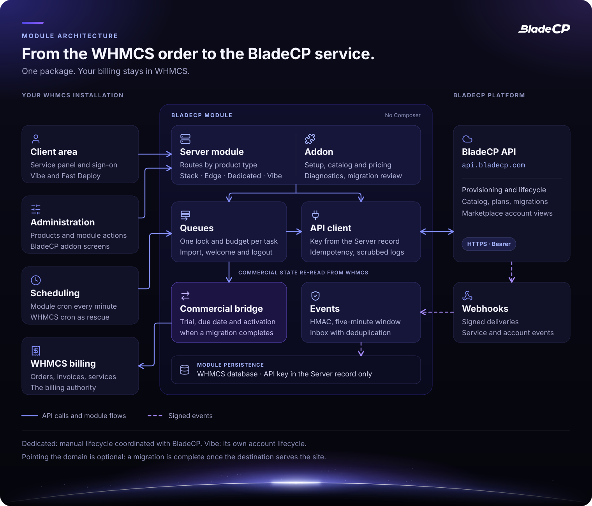
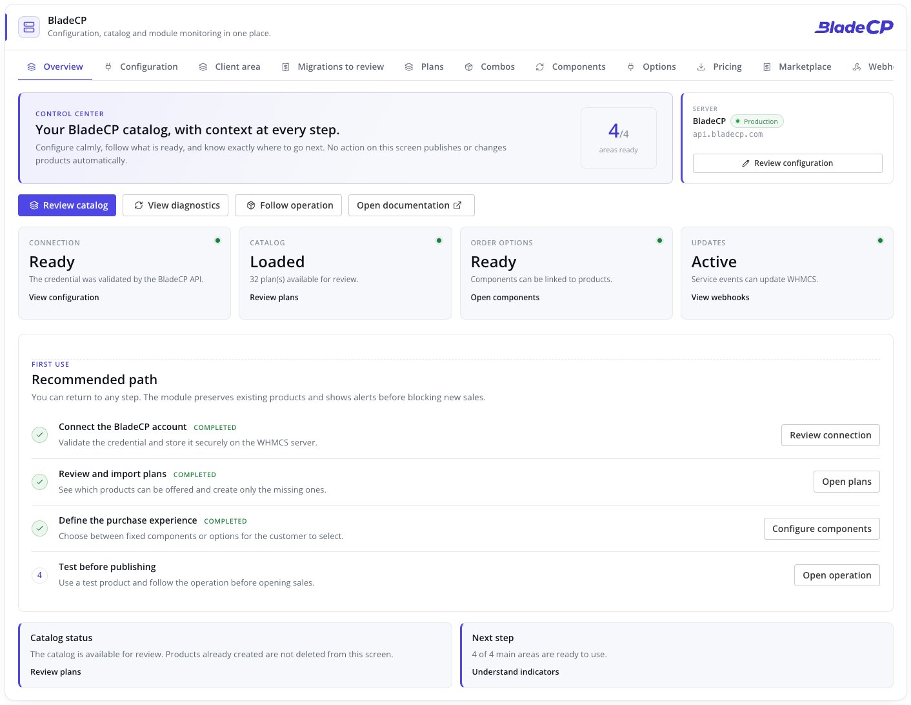
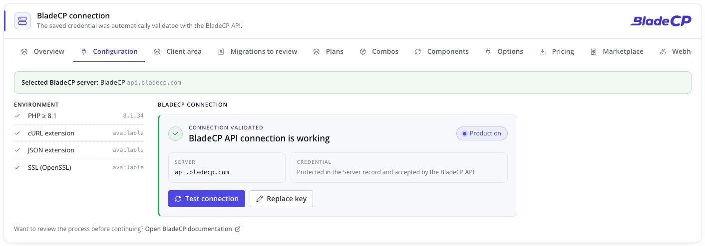
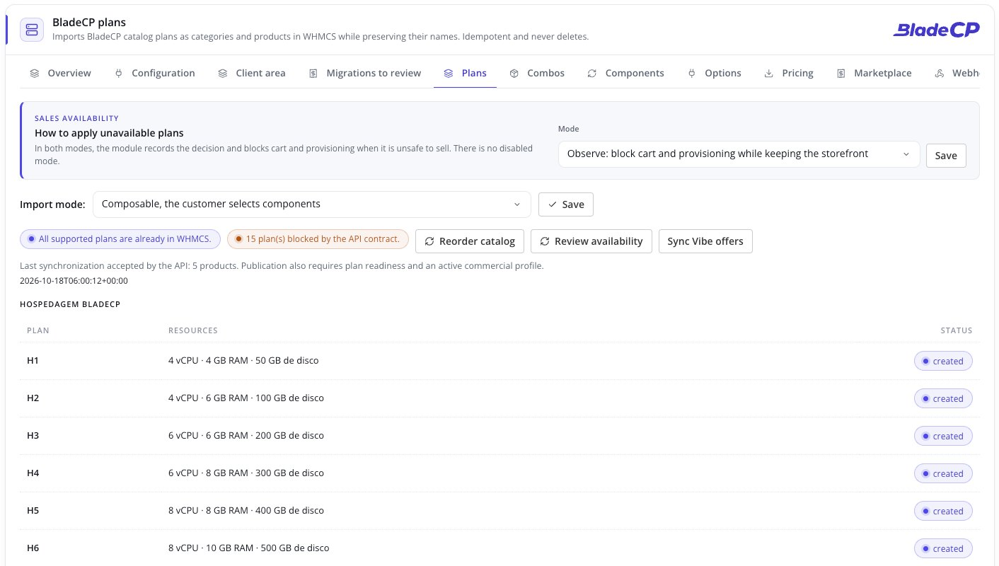
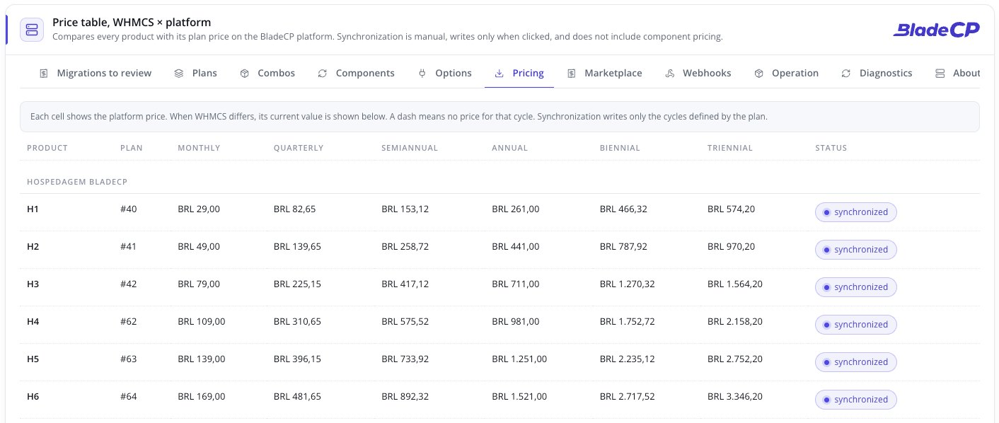
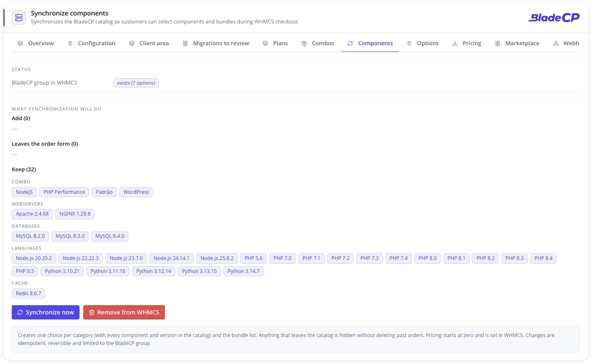
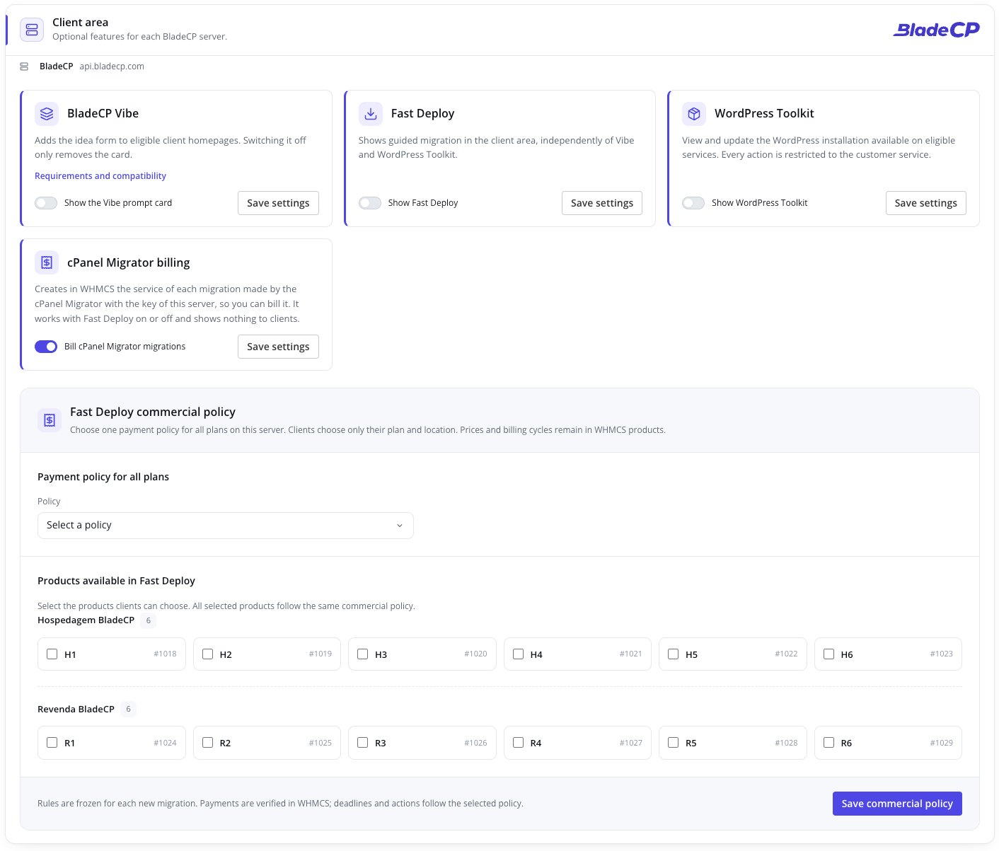
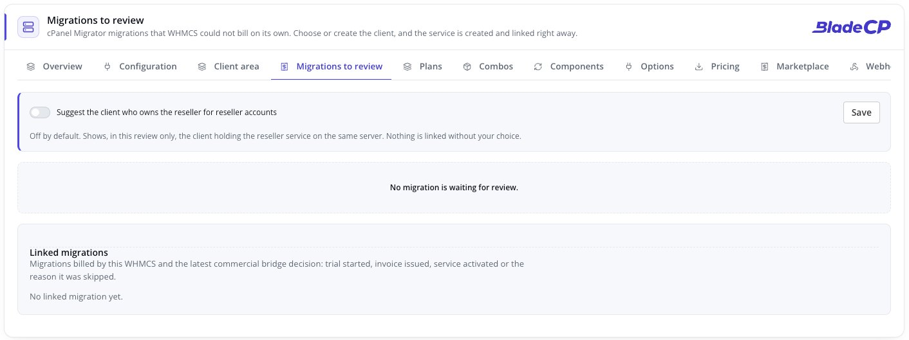
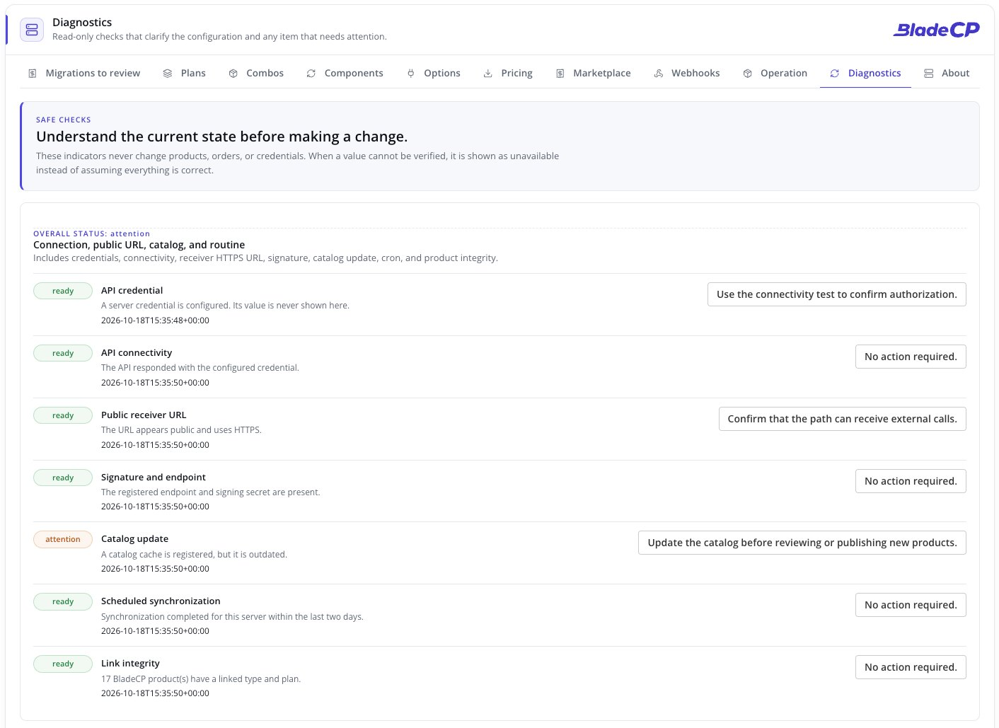

<p align="center">
  <picture>
    <source media="(max-width: 600px)" srcset="assets/hero-compact.en.svg">
    
  </picture>
</p>

<p align="center">
  <strong>Provision and manage BladeCP services directly from WHMCS.</strong><br>
  The official open-source module that connects your WHMCS to the BladeCP Customer API.
</p>

<p align="center">
  <a href="CHANGELOG.md"></a>
  <a href="#requirements"></a>
  <a href="#requirements"></a>
  <a href="#requirements"></a><br>
  <a href="#quality"></a>
  <a href="CHANGELOG.md"></a>
  <a href="LICENSE"></a>
  <a href="https://github.com/bladecp/bladecp-whmcs/actions/workflows/ci.yml"></a>
</p>

<p align="center">
  <a href="https://github.com/bladecp/bladecp-whmcs/releases/download/v0.9.0-rc.11/bladecp-whmcs-0.9.0-rc.11.zip"><strong>Download BladeCP for WHMCS (.zip)</strong></a>
  &nbsp;·&nbsp;
  <a href="https://github.com/bladecp/bladecp-whmcs/releases/tag/v0.9.0-rc.11">Release notes</a>
  &nbsp;·&nbsp;
  <a href="https://github.com/bladecp/bladecp-whmcs/releases/download/v0.9.0-rc.11/SHA256SUMS">SHA-256 checksum</a>
</p>

<p align="center">
  <a href="#features">Features</a> ·
  <a href="#architecture">Architecture</a> ·
  <a href="#installation">Installation</a> ·
  <a href="#configuration">Configuration</a> ·
  <a href="#interface">Interface</a> ·
  <a href="#documentation">Documentation</a> ·
  <a href="#security">Security</a> ·
  <a href="#support">Support</a>
  <br>
  <sub><a href="README.pt-BR.md">Português (Brasil)</a> · <a href="README.es.md">Español</a></sub>
</p>

> [!IMPORTANT]
> **Release candidate `0.9.0-rc.11`.** This pre-release is for partner
> validation. Test it in a non-production WHMCS environment before customer use.

BladeCP for WHMCS is the official open-source provisioning module for hosting
providers that sell BladeCP services from their own WHMCS installation. It
connects a WHMCS server record to the BladeCP Customer API, so orders and
service actions remain part of the provider's existing billing workflow.

The module supports **Stack Container**, **Edge Cloud (VPS)**, **Dedicated** and
eligible **Vibe** products through one installable package. Vibe uses a
dedicated account lifecycle, while the partner keeps customer billing in WHMCS.

<a id="features"></a>

## Built for BladeCP partners

| One module | Operational control | Optional administration |
| --- | --- | --- |
| Route Stack, Edge, Dedicated and Vibe products from a single WHMCS module. | Create, suspend, unsuspend, change package, terminate and open single sign-on where supported by the selected product. | Activate the companion addon for guided setup, catalog import, configurable options, webhooks and diagnostics. |

### Products and lifecycle

| Product | What the module does | Scope in this candidate |
| --- | --- | --- |
| **Stack Container** | Create, suspend, unsuspend, change package, change password, terminate, cancellation requests and single sign-on | Regular WHMCS provisioning lifecycle |
| **Edge Cloud (VPS)** | The same lifecycle as Stack Container | Regular WHMCS provisioning lifecycle |
| **Dedicated** | Available through the same module and product type routing | Manual lifecycle coordinated with BladeCP operations |
| **Vibe** | Account creation, plan changes, suspension, reactivation, termination and single sign-on | Eligible plans only, with a dedicated account lifecycle and no infrastructure usage synchronization |

Stack and Edge are designed for the regular WHMCS provisioning lifecycle.
Dedicated products are available through the same module, but their
provisioning and lifecycle can require explicit manual handling according to
the service offered by the platform. Confirm the available operations for the
plan you sell before enabling automated customer flows.

### Provisioning and service management

- Provision eligible Stack, Edge, Dedicated and Vibe services from WHMCS orders.
- Suspend, unsuspend, change package and terminate services through standard WHMCS actions where the selected product supports the operation.
- Open the BladeCP panel with single sign-on.
- Display a branded service panel in the WHMCS client area.
- Synchronize service usage for WHMCS billing workflows.
- Record cancellation intent with **Cancel now** and **Cancel at cycle end** actions.
- Offer opt-in federated sign-in for Vibe and a scoped support entry for authorized operators.

### Optional BladeCP addon

The provisioner works without the addon. When enabled, the addon adds a
WHMCS-native administration surface for:

- Guided server setup and connection validation.
- Idempotent catalog import, from BladeCP plans to WHMCS product groups and products.
- Simple or composable product choices, component combinations and configurable-option synchronization.
- Webhook registration, diagnostics and a read-only marketplace account view.
- Client area options per server, such as the Vibe prompt card and Fast Deploy.
- Migration review, to choose or create the client of a migration that could not be billed automatically.

### Scheduled work and migrations

- **A cron of its own.** The addon runs its light queues every minute and its
  daily synchronization once a day. Each task has its own lock, time budget and
  error record, so one failing task never stops the others.
- **The WHMCS cron as rescue.** If the module cron stops, the WHMCS cron runs a
  limited rescue: the queues after 15 minutes without a heartbeat and the daily
  synchronization after 36 hours without a success.
- **Daily synchronization that preserves prices.** Configurable options,
  catalog availability and the webhook ledger stay in order without touching
  existing pricing rows.
- **cPanel Migrator billing.** Migrations made by the cPanel Migrator with the
  key of a server become native WHMCS services, so you bill them in WHMCS. An
  owner is matched only from a cPanel service that WHMCS already holds; any
  other case is confirmed by the account holder or decided by an administrator.
- **Fast Deploy.** An optional client area flow to migrate from a full cPanel
  backup, with one commercial policy for all plans of a server: pay before
  migrating, migrate and pay to activate, or migrate and try. Trial, due date
  and activation apply when the migration completes.

## Explore the live demo

See the module in a prepared WHMCS environment: [whmcs-demo.bladecp.com](https://whmcs-demo.bladecp.com/).

This environment is for demonstration only. Do not enter real personal,
financial or credential information.

## Architecture

The module separates the WHMCS experience, the work that runs on its own
schedule and the communication with BladeCP. WHMCS remains the billing
authority: every commercial transition is read again from its orders, invoices
and services.

<p align="center">
  <picture>
    <source media="(max-width: 600px)" srcset="assets/architecture-compact.en.svg">
    
  </picture>
</p>

<p align="center"><sub>Logical view of the module. <a href="assets/architecture.en.svg">Open the diagram at full size</a>.</sub></p>

### From order to service

1. **WHMCS starts the flow.** An order, an administrator action or the client
   area calls the server module, which routes by the **BladeCP Product Type**.
2. **The API client talks to BladeCP.** It reads the key from the WHMCS server
   record and calls `api.bladecp.com` over HTTPS with an idempotency key.
   Module logs are scrubbed before they are written.
3. **Scheduled work keeps going.** The module cron runs the queues every minute,
   each with its own lock and time budget. The WHMCS cron only steps in when
   the module cron stops.
4. **Events come back signed.** Webhooks are verified, signature and replay
   window included, before a persistent inbox applies them to the linked
   service without duplicates.
5. **Billing stays in WHMCS.** For migrations, the commercial bridge applies
   trial, due date and activation to the native service when the migration
   completes. Pointing the domain is optional.

| Layer | Responsibility |
| --- | --- |
| **Server module** | WHMCS callbacks, routing by product type, client area service panel and single sign-on |
| **Addon** (optional) | Setup, catalog, pricing, client area options, diagnostics and migration review |
| **Queues and module cron** | Federated logout, Vibe welcome, cPanel Migrator billing import and the commercial bridge |
| **API client** | Credential from the server record, idempotency, scrubbed logs and parallel reads |
| **Events** | Signature check, replay window and a persistent inbox with deduplication |
| **Persistence** | WHMCS database tables, with the API key kept only in the server record |

<a id="download"></a>

## Downloads and release notes

**`0.9.0-rc.11`** is the current release candidate. It limits the package to
the production BladeCP environment, documents the module cron as the scheduler
requirement and moves the public hygiene gate to generic rules, as described
in the [changelog](CHANGELOG.md). Every published
release provides the installable ZIP and its SHA-256 checksum. Review the
release notes before upgrading.

| File | Purpose |
| --- | --- |
| [**bladecp-whmcs-0.9.0-rc.11.zip**](https://github.com/bladecp/bladecp-whmcs/releases/download/v0.9.0-rc.11/bladecp-whmcs-0.9.0-rc.11.zip) | Installable package, containing only `modules/` |
| [**SHA256SUMS**](https://github.com/bladecp/bladecp-whmcs/releases/download/v0.9.0-rc.11/SHA256SUMS) | Checksum to verify the integrity of the ZIP |
| [**RELEASE_NOTES.md**](https://github.com/bladecp/bladecp-whmcs/releases/download/v0.9.0-rc.11/RELEASE_NOTES.md) | Notes that accompany this package |

See the [release page](https://github.com/bladecp/bladecp-whmcs/releases/tag/v0.9.0-rc.11)
or [all BladeCP for WHMCS releases](https://github.com/bladecp/bladecp-whmcs/releases).
The automatic **Source code** archives from GitHub contain the repository; to
install the module, use the ZIP listed above.

<a id="requirements"></a>

## Requirements and compatibility

| Component | Requirement or supported baseline |
| --- | --- |
| WHMCS | 8.x and 9.x. |
| PHP | 8.1 or newer. |
| Database | Any database engine and version supported by the installed WHMCS release. The module adds no database-specific requirement. |
| WHMCS themes | Themes that preserve standard WHMCS hooks and markup. |
| Browser | Current evergreen browsers supported by WHMCS. The module has no browser-specific dependency. |
| Languages | Client-facing module and addon administration: English, Portuguese (Brazil) and Spanish. |
| Runtime dependencies | PHP cURL, JSON and OpenSSL extensions |

The supported range stays WHMCS 8.x and 9.x with PHP 8.1 or newer. The last
complete validation matrix was run for `0.9.0-rc.4`, with WHMCS 8.13.3 and
9.0.6, PHP 8.2.31, MariaDB 12.3.2, the Blend administration theme and the
Twenty-One, Six and Nexus client themes. These are tested environments, not
additional minimum requirements. Release candidates of the 0.9.0 line run in
production WHMCS installations of partners. Test the release in a
non-production WHMCS installation before making it available to customers.

You also need:

- Administrative access to a compatible WHMCS installation.
- A BladeCP partner account.
- A BladeCP Customer API key.
- PHP with the cURL, JSON and OpenSSL extensions enabled.
- Outbound HTTPS access to `api.bladecp.com`.
- The module cron, run every minute from the server crontab, for the module queues and daily synchronization. See [Module cron](docs/configuration.md#module-cron).
- The standard WHMCS cron, for WHMCS billing automation and the native usage update. It also rescues the module tasks if the module cron stops.
- A public HTTPS endpoint if you enable incoming webhooks.

<a id="installation"></a>

## Quick installation

Install from a [GitHub Release](https://github.com/bladecp/bladecp-whmcs/releases),
not from a source snapshot. No Composer or build step is required on the WHMCS
server.

1. Download the release ZIP and its accompanying `SHA256SUMS` file.
2. Verify the artifact from the directory that contains both files:

   ```bash
   shasum -a 256 -c SHA256SUMS
   ```

   On Linux, you can instead run:

   ```bash
   sha256sum -c SHA256SUMS
   ```

3. Back up your WHMCS files and database before updating or installing the module.
4. Extract the ZIP into the root of your WHMCS installation. After extraction, these directories must exist:

   ```text
   modules/servers/bladecp/
   modules/addons/bladecp/
   ```

   The installable ZIP contains only `modules/`. It does not overwrite a
   WHMCS root README, license or documentation file.

5. In WHMCS, create or select a server under **System Settings → Products/Services → Servers**.
6. Configure the BladeCP connection, then run **Test Connection** before assigning the module to a product.
7. To use guided setup, catalog tools, configurable options or webhooks, activate **BladeCP** under **System Settings → Addon Modules**.
8. Add the module cron to the crontab of the user that runs the WHMCS PHP, and keep the WHMCS cron as well:

   ```text
   * * * * * php -q '/path/to/whmcs/modules/addons/bladecp/cron.php'
   ```

   The **Diagnostics** tab of the addon shows the exact command for your server.

See the [detailed installation guide](docs/installation.md) for the full procedure.

### Updating

For an update, verify the release checksum and back up your WHMCS files and
database first. Extract the new ZIP over the existing WHMCS root. Do not delete
the existing `modules/servers/bladecp/` or `modules/addons/bladecp/`
directories before extracting the update. Your server records, products and
module settings remain in WHMCS. See the
[detailed installation guide](docs/installation.md) for the complete update
procedure.

## Configuration

### Recommended: guided setup

Activate the BladeCP addon, open its **Quick Setup** flow, enter the Customer
API key and validate the connection. The wizard creates the BladeCP server
record using the standard WHMCS fields.

### Manual server setup

Create a WHMCS server with these values:

| Field | Value |
| --- | --- |
| Module | `bladecp` |
| Hostname | `api.bladecp.com` |
| Secure | Enabled |
| Access Hash | Your BladeCP Customer API key |

The API key belongs in the WHMCS server record's **Access Hash** field. The
optional addon does not require a second copy of that credential.

Next, create a WHMCS product, select the `bladecp` module and choose its
**BladeCP Product Type** and **BladeCP Plan**. The addon can import catalog
entries and synchronize customer-facing configurable options when that
workflow fits your store.

> [!WARNING]
> Set the hostname explicitly. An empty hostname uses the production API endpoint.

The [configuration guide](docs/configuration.md) covers Dedicated services,
Vibe, the optional Vibe prompt card, federated sign-in, webhooks and the
module cron.

<a id="interface"></a>

## See it in WHMCS

<p align="center">
  
</p>

| Configuration | Plans and catalog |
| --- | --- |
|  |  |

| Pricing | Components |
| --- | --- |
|  |  |

| Client area | Migrations to review |
| --- | --- |
|  |  |

<p align="center">
  
</p>

The captures show the addon area of a WHMCS that runs the module, with no
data of the installation. The final appearance also depends on your WHMCS
theme and version.

## Documentation

| Guide | What you will find |
| --- | --- |
| [Installation](docs/installation.md) | Download, checksum, extraction and updates |
| [Configuration](docs/configuration.md) | Server record, products, Dedicated, Vibe, webhooks and cron |
| [Compatibility](docs/compatibility.md) | Requirements, supported baselines and validation snapshot |
| [Troubleshooting](docs/troubleshooting.md) | Checks for connection, catalog, webhook and Vibe issues |
| [Release process](docs/release-process.md) | How public releases are prepared and verified |
| [Repository governance](docs/repository-governance.md) | Issues, pull requests, history and releases |
| [Changelog](CHANGELOG.md) | Changes in each public version |
| [Security policy](SECURITY.md) | Private vulnerability reporting |
| [Contributing](CONTRIBUTING.md) | How to propose and validate a change |

## Security

- **One place for the credential.** Store the Customer API key only in the
  WHMCS server record. The addon keeps no copy of it.
- **Verified webhooks.** Incoming webhooks verify their signatures, within a
  five-minute replay window, before applying a service update. A persistent
  inbox discards duplicates.
- **Scrubbed logs.** Module logs remove API keys and sensitive fields before
  they are written. Still, treat API keys, webhook signing secrets and module
  logs as sensitive operational data.
- **Closed by default where it matters.** Credential writes, CSRF checks,
  server selection, sale eligibility, webhook verification and Vibe identity
  transitions stop when they cannot be confirmed.
- **Up to date.** Keep WHMCS, PHP and this module up to date with the release
  you have verified.

To report a vulnerability privately, follow [SECURITY.md](SECURITY.md). Please
do not include credentials, webhook payloads or customer data in a public issue.

<a id="quality"></a>

## Quality and validation

Release candidate `0.9.0-rc.11` was validated by the maintainers with
**1,092 automated checks**: 732 deterministic checks of mapping, routing, sale
guards, secret scrubbing, catalog, webhook and Vibe flows, and 360 integration
checks that exercise hooks, schema upgrades, encrypted setup, the cURL
transport and the public webhook entry point in a simulated WHMCS runtime,
on PHP 8.2. The tests badge represents that run.

Before a package is built, every PHP file passes a syntax check and the public
tree is scanned for credentials and non-public references. The release
process also requires validating the ZIP on its own in a disposable WHMCS
installation before it is published.

This repository includes its own regression checks (`tests/run.php`) and the
structure and hygiene gate (`scripts/check-public-tree.sh`). The
[public CI](https://github.com/bladecp/bladecp-whmcs/actions/workflows/ci.yml)
runs both on PHP 8.1 and 8.2. Automated checks do not replace validation in
your own WHMCS before customer use.

<a id="development"></a>

## Development and contributing

WHMCS loads `modules/` directly: there is no build step and no Composer
dependency. Use PHP 8.1 or newer; PHP 8.2 is recommended.

```sh
git clone https://github.com/bladecp/bladecp-whmcs.git
cd bladecp-whmcs
find modules tests -name '*.php' -print0 | xargs -0 -n1 php -l
php tests/run.php
bash scripts/check-public-tree.sh
```

```text
modules/
  servers/bladecp/    Server module: callbacks, routing, API client, client area
  addons/bladecp/     Optional addon: setup, catalog, cron, webhooks, diagnostics
tests/run.php         Public regression checks
scripts/              Public structure and hygiene gate
docs/                 Installation, configuration and operation guides
assets/               README artwork and localized screenshots
```

Contributions are welcome. Read [CONTRIBUTING.md](CONTRIBUTING.md) before
opening an issue or pull request, keep changes focused, add relevant coverage,
and never commit credentials or customer data. Approved contributions follow
the project maintenance workflow before they appear in a later public release.

<a id="faq"></a>

## Frequently asked questions

<details>
<summary><strong>Do I need Composer or a build step on the WHMCS server?</strong></summary>

No. The ZIP contains `modules/` with a native autoloader. Extract it into the
WHMCS root and the module is ready to configure.

</details>

<details>
<summary><strong>Where does the API key go?</strong></summary>

In the **Access Hash** field of the WHMCS server record. The guided setup
writes it there for you. The optional addon never needs a second copy.

</details>

<details>
<summary><strong>Is the addon required?</strong></summary>

No. Basic provisioning works with the server module alone. Guided setup,
catalog import, configurable options, webhooks, diagnostics, Vibe activation
and migration billing need the addon.

</details>

<details>
<summary><strong>Is the WHMCS cron enough?</strong></summary>

No. Add the module cron every minute: it runs the module queues and the daily
synchronization. Keep the WHMCS cron for WHMCS billing automation and the
native usage update. If the module cron stops, the WHMCS cron rescues the
queues after 15 minutes and the daily synchronization after 36 hours.

</details>

<details>
<summary><strong>Does pointing the domain hold a migration back?</strong></summary>

No. A migration counts as complete once the destination serves the site.
Trial, due date and activation follow from there; pointing the domain is
optional.

</details>

<details>
<summary><strong>Can I try it before installing?</strong></summary>

Yes. The [live demo](https://whmcs-demo.bladecp.com/) shows the module in a
prepared WHMCS environment. Do not enter real data there.

</details>

## Support

| Subject | Channel |
| --- | --- |
| Reproducible bug or product request | [GitHub Issues](https://github.com/bladecp/bladecp-whmcs/issues) |
| Technical and product support | [dev@bladecp.com](mailto:dev@bladecp.com) |
| Vulnerability | [Security policy](SECURITY.md) |
| Live demonstration | [whmcs-demo.bladecp.com](https://whmcs-demo.bladecp.com/) |

In public reports, use neutral data. Keep credentials, customer information
and webhook payloads in private channels.

## License

BladeCP for WHMCS is released under the [MIT License](LICENSE). The module
license does not replace the WHMCS license or the terms of BladeCP services.

<p align="center"><strong>BladeCP. Your store, our infrastructure.</strong></p>
