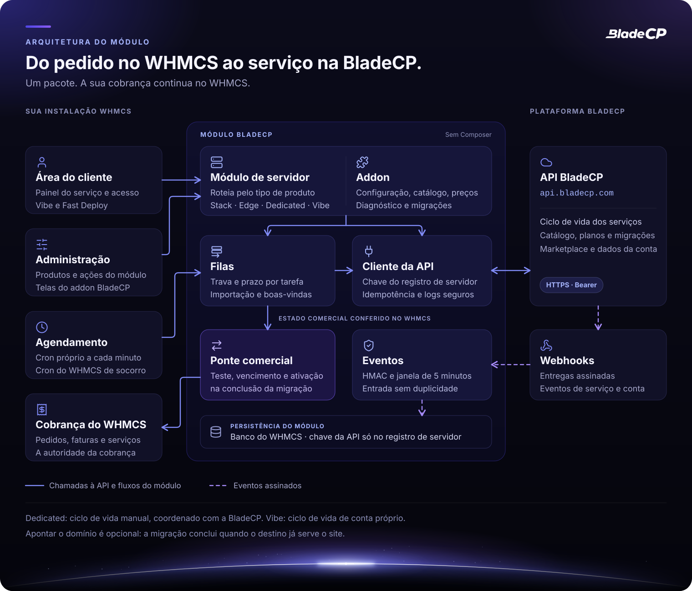
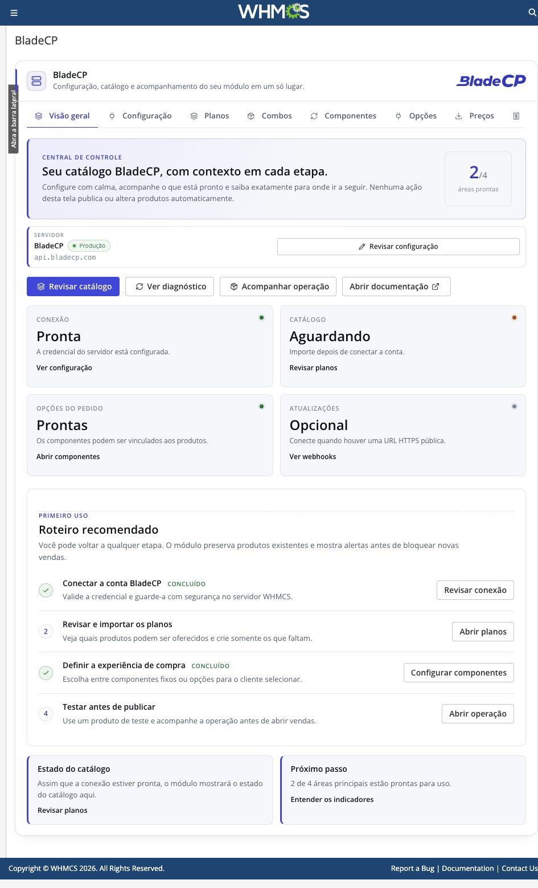
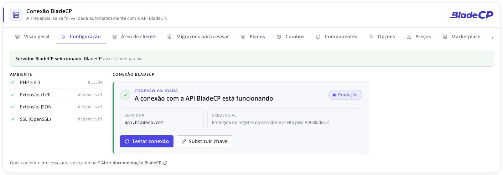
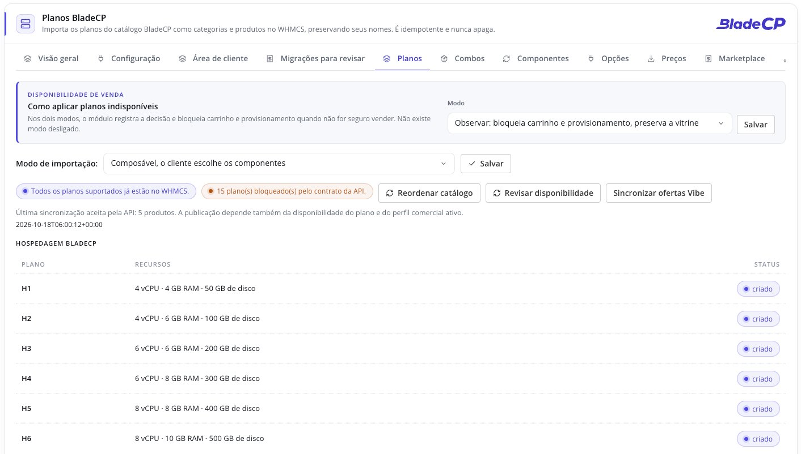
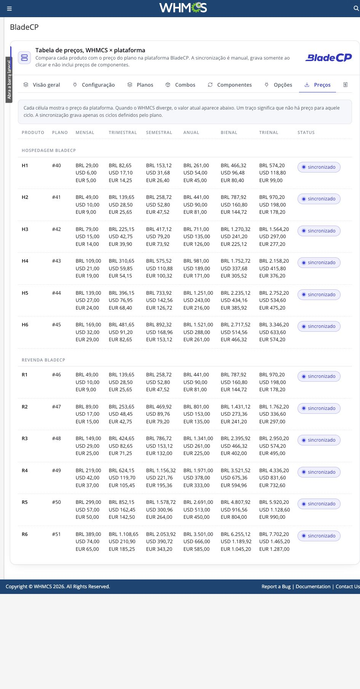
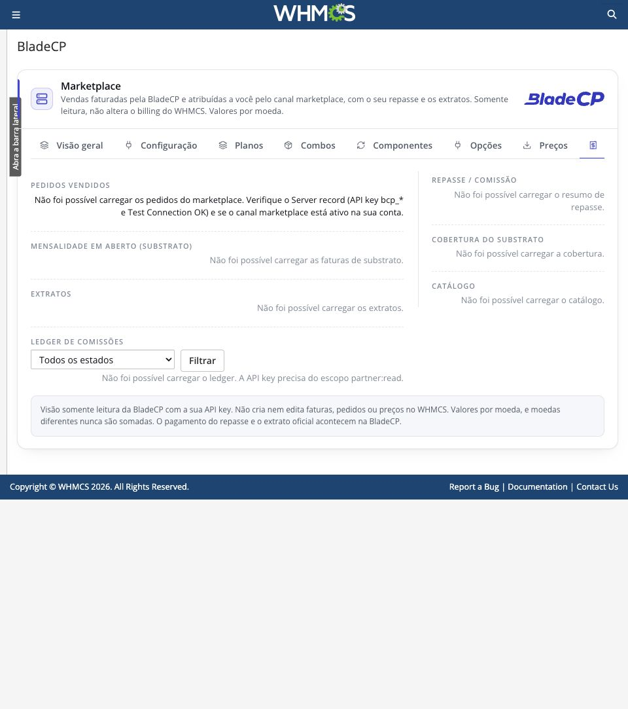
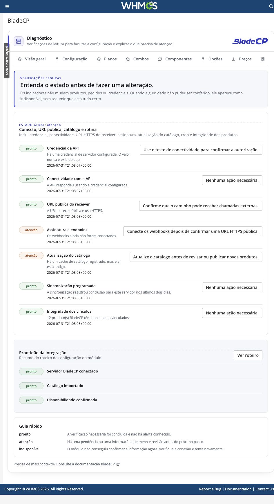
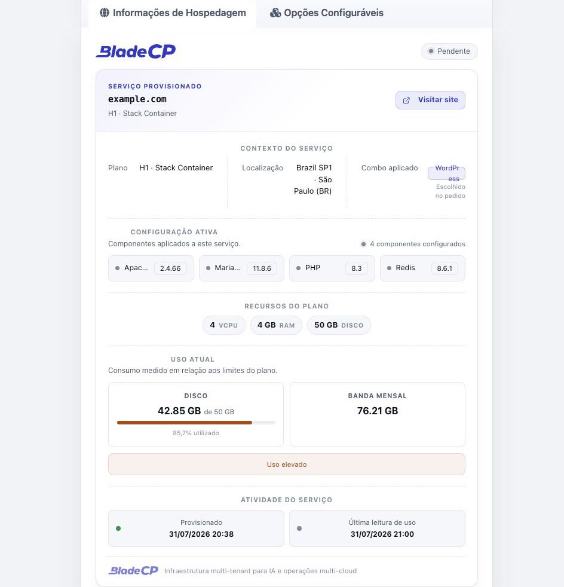

<p align="center">
  <picture>
    <source media="(max-width: 600px)" srcset="assets/hero-compact.pt-BR.svg">
    
  </picture>
</p>

<p align="center">
  <strong>Provisione e gerencie serviços BladeCP diretamente pelo WHMCS.</strong><br>
  O módulo oficial e open source que conecta o seu WHMCS à Customer API da BladeCP.
</p>

<p align="center">
  <a href="CHANGELOG.md"></a>
  <a href="#requisitos"></a>
  <a href="#requisitos"></a>
  <a href="#requisitos"></a><br>
  <a href="#qualidade"></a>
  <a href="CHANGELOG.md"></a>
  <a href="LICENSE"></a>
  <a href="https://github.com/bladecp/bladecp-whmcs/actions/workflows/ci.yml"></a>
</p>

<p align="center">
  <a href="https://github.com/bladecp/bladecp-whmcs/releases/download/v0.9.0-rc.10/bladecp-whmcs-0.9.0-rc.10.zip"><strong>Baixar BladeCP para WHMCS (.zip)</strong></a>
  &nbsp;·&nbsp;
  <a href="https://github.com/bladecp/bladecp-whmcs/releases/tag/v0.9.0-rc.10">Notas da versão</a>
  &nbsp;·&nbsp;
  <a href="https://github.com/bladecp/bladecp-whmcs/releases/download/v0.9.0-rc.10/SHA256SUMS">Checksum SHA-256</a>
</p>

<p align="center">
  <a href="#recursos">Recursos</a> ·
  <a href="#arquitetura">Arquitetura</a> ·
  <a href="#instalacao">Instalação</a> ·
  <a href="#configuracao">Configuração</a> ·
  <a href="#interface">Interface</a> ·
  <a href="#documentacao">Documentação</a> ·
  <a href="#seguranca">Segurança</a> ·
  <a href="#suporte">Suporte</a>
  <br>
  <sub><a href="README.md">English</a> · <a href="README.es.md">Español</a></sub>
</p>

> [!IMPORTANT]
> **Versão candidata `0.9.0-rc.10`.** Esta é uma pré-release para validação de
> parceiros. Teste-a fora de produção antes de disponibilizá-la aos clientes.

BladeCP para WHMCS é o módulo oficial e open source de provisionamento para
provedores que vendem serviços BladeCP a partir da própria instalação WHMCS.
Ele conecta um servidor do WHMCS à Customer API da BladeCP, mantendo pedidos e
ações de serviço no fluxo de cobrança já utilizado pelo provedor.

O módulo oferece suporte a produtos **Stack Container**, **Edge Cloud (VPS)**,
**Dedicated** e **Vibe** elegíveis em um único pacote instalável. O Vibe usa
ciclo de vida de conta próprio, enquanto o partner mantém a cobrança do cliente
no WHMCS.

<a id="recursos"></a>

## Feito para parceiros BladeCP

| Um módulo | Controle operacional | Administração opcional |
| --- | --- | --- |
| Direcione produtos Stack, Edge, Dedicated e Vibe por um único módulo WHMCS. | Crie, suspenda, reative, altere plano, encerre e abra o single sign-on quando a operação for suportada pelo produto escolhido. | Ative o addon complementar para setup guiado, importação de catálogo, opções configuráveis, webhooks e diagnósticos. |

### Produtos e ciclo de vida

| Produto | O que o módulo faz | Escopo nesta candidata |
| --- | --- | --- |
| **Stack Container** | Criação, suspensão, reativação, troca de plano, troca de senha, encerramento, pedidos de cancelamento e single sign-on | Ciclo regular de provisionamento do WHMCS |
| **Edge Cloud (VPS)** | O mesmo ciclo de vida do Stack Container | Ciclo regular de provisionamento do WHMCS |
| **Dedicated** | Disponível pelo mesmo módulo e pelo mesmo roteamento por tipo de produto | Ciclo de vida manual, coordenado com a operação da BladeCP |
| **Vibe** | Criação de conta, troca de plano, suspensão, reativação, encerramento e single sign-on | Somente planos elegíveis, com ciclo de vida de conta próprio e sem sincronização de uso de infraestrutura |

Stack e Edge foram desenhados para o ciclo regular de provisionamento do WHMCS.
Produtos Dedicated estão disponíveis pelo mesmo módulo, mas seu provisionamento
e ciclo de vida podem exigir tratamento manual explícito conforme o serviço
oferecido pela plataforma. Confirme as operações disponíveis para o plano que
você vende antes de habilitar fluxos automáticos para clientes.

### Provisionamento e gestão de serviços

- Provisione serviços Stack, Edge, Dedicated e Vibe elegíveis a partir de pedidos WHMCS.
- Suspenda, reative, altere plano e encerre serviços por ações padrão do WHMCS quando a operação for suportada pelo produto escolhido.
- Abra o painel BladeCP com single sign-on.
- Exiba um painel de serviço com a marca BladeCP na área do cliente do WHMCS.
- Sincronize uso do serviço para fluxos de cobrança do WHMCS.
- Registre a intenção de cancelamento com as ações **Cancelar agora** e **Cancelar no fim do ciclo**.
- Ofereça acesso federado opcional ao Vibe e uma entrada de suporte restrita para operadores autorizados.

### Addon BladeCP opcional

O provisionador funciona sem o addon. Quando ativado, o addon acrescenta uma
área administrativa nativa do WHMCS para:

- Setup guiado do servidor e validação de conexão.
- Importação idempotente de catálogo, dos planos BladeCP para grupos e produtos WHMCS.
- Produtos simples ou compostos, combinações de componentes e sincronização de opções configuráveis.
- Registro de webhooks, diagnósticos e uma visão somente leitura da conta Marketplace.
- Opções da área do cliente por servidor, como o card de prompt do Vibe e o Fast Deploy.
- Revisão de migrações, para escolher ou criar o cliente de uma migração que não pôde ser cobrada automaticamente.

### Rotinas agendadas e migrações

- **Um cron próprio.** O addon roda as filas leves a cada minuto e a
  sincronização diária uma vez por dia. Cada tarefa tem trava, prazo e
  registro de erro próprios, então uma falha nunca impede as demais.
- **O cron do WHMCS como socorro.** Se o cron do módulo parar, o cron do WHMCS
  faz um socorro limitado: as filas após 15 minutos sem sinal de vida e a
  sincronização diária após 36 horas sem sucesso.
- **Sincronização diária que preserva preços.** Opções configuráveis,
  disponibilidade do catálogo e o registro de webhooks ficam em ordem sem
  alterar as linhas de preço existentes.
- **Cobrança do cPanel Migrator.** Migrações feitas pelo cPanel Migrator com a
  chave de um servidor viram serviços nativos do WHMCS, para que você as cobre
  no WHMCS. O dono só é reconhecido a partir de um serviço cPanel que o WHMCS
  já possui; os demais casos são confirmados pelo titular da conta ou decididos
  por um administrador.
- **Fast Deploy.** Um fluxo opcional na área do cliente para migrar a partir de
  um backup completo do cPanel, com uma política comercial para todos os planos
  do servidor: pagar antes de migrar, migrar e pagar para ativar, ou migrar e
  testar. Teste, vencimento e ativação valem quando a migração conclui.

## Explore a demonstração online

Veja o módulo em um ambiente WHMCS preparado: [whmcs-demo.bladecp.com](https://whmcs-demo.bladecp.com/).

Este ambiente é apenas demonstrativo. Não informe dados pessoais, financeiros
ou credenciais reais.

## Arquitetura

O módulo separa a experiência no WHMCS, o trabalho que roda na própria agenda
e a comunicação com a BladeCP. O WHMCS continua sendo a autoridade da
cobrança: cada transição comercial é conferida de novo nos pedidos, faturas e
serviços dele.

<p align="center">
  <picture>
    <source media="(max-width: 600px)" srcset="assets/architecture-compact.pt-BR.svg">
    
  </picture>
</p>

<p align="center"><sub>Visão lógica do módulo. <a href="assets/architecture.pt-BR.svg">Abrir o diagrama em tamanho real</a>.</sub></p>

### Do pedido ao serviço

1. **O WHMCS inicia o fluxo.** Um pedido, uma ação do administrador ou a área
   do cliente aciona o módulo de servidor, que roteia pelo **BladeCP Product Type**.
2. **O cliente da API fala com a BladeCP.** Ele lê a chave do registro de
   servidor do WHMCS e chama `api.bladecp.com` por HTTPS com uma chave de
   idempotência. Os logs do módulo são mascarados antes da gravação.
3. **As rotinas agendadas seguem.** O cron do módulo roda as filas a cada
   minuto, cada uma com trava e prazo próprios. O cron do WHMCS só entra em
   ação quando o cron do módulo para.
4. **Os eventos voltam assinados.** Os webhooks são verificados, com
   assinatura e janela contra repetição, antes que uma caixa de entrada
   persistente os aplique ao serviço vinculado, sem duplicidade.
5. **A cobrança fica no WHMCS.** Nas migrações, a ponte comercial aplica
   teste, vencimento e ativação ao serviço nativo quando a migração conclui.
   Apontar o domínio é opcional.

| Camada | Responsabilidade |
| --- | --- |
| **Módulo de servidor** | Callbacks do WHMCS, roteamento por tipo de produto, painel do serviço na área do cliente e single sign-on |
| **Addon** (opcional) | Configuração, catálogo, preços, opções da área do cliente, diagnóstico e revisão de migrações |
| **Filas e cron do módulo** | Saída do acesso federado, boas-vindas do Vibe, importação da cobrança do cPanel Migrator e ponte comercial |
| **Cliente da API** | Credencial do registro de servidor, idempotência, logs mascarados e leituras em paralelo |
| **Eventos** | Verificação de assinatura, janela contra repetição e caixa de entrada persistente sem duplicidade |
| **Persistência** | Tabelas no banco do WHMCS, com a chave da API somente no registro de servidor |

<a id="downloads"></a>

## Downloads e notas da versão

**`0.9.0-rc.10`** é a versão candidata atual. Ela limita o pacote ao ambiente
de produção da BladeCP, registra o cron do módulo como requisito de agendamento
e passa o portão público de higiene para regras genéricas, conforme o
[changelog](CHANGELOG.md). Toda release
publicada disponibiliza o ZIP instalável e seu checksum SHA-256. Leia as notas
da versão antes de atualizar.

| Arquivo | Finalidade |
| --- | --- |
| [**bladecp-whmcs-0.9.0-rc.10.zip**](https://github.com/bladecp/bladecp-whmcs/releases/download/v0.9.0-rc.10/bladecp-whmcs-0.9.0-rc.10.zip) | Pacote instalável, contendo somente `modules/` |
| [**SHA256SUMS**](https://github.com/bladecp/bladecp-whmcs/releases/download/v0.9.0-rc.10/SHA256SUMS) | Checksum para conferir a integridade do ZIP |
| [**RELEASE_NOTES.md**](https://github.com/bladecp/bladecp-whmcs/releases/download/v0.9.0-rc.10/RELEASE_NOTES.md) | Notas que acompanham este pacote |

Consulte a [página desta release](https://github.com/bladecp/bladecp-whmcs/releases/tag/v0.9.0-rc.10)
ou [todas as releases do BladeCP para WHMCS](https://github.com/bladecp/bladecp-whmcs/releases).
Os arquivos automáticos **Source code** do GitHub contêm o repositório; para
instalar o módulo, use o ZIP indicado na tabela.

<a id="requisitos"></a>

## Requisitos e compatibilidade

| Componente | Requisito ou base de suporte |
| --- | --- |
| WHMCS | 8.x e 9.x. |
| PHP | 8.1 ou superior. |
| Banco de dados | Qualquer mecanismo e versão de banco compatível com a release instalada do WHMCS. O módulo não adiciona requisito específico de banco. |
| Temas WHMCS | Temas que preservem os hooks e o markup padrão do WHMCS. |
| Navegador | Navegadores modernos suportados pelo WHMCS. O módulo não possui dependência específica de navegador. |
| Idiomas | Módulo voltado ao cliente e administração do addon: inglês, português (Brasil) e espanhol. |
| Dependências de runtime | Extensões PHP cURL, JSON e OpenSSL |

A faixa suportada continua sendo WHMCS 8.x e 9.x com PHP 8.1 ou superior. A
última matriz completa de validação foi feita na `0.9.0-rc.4`, com WHMCS
8.13.3 e 9.0.6, PHP 8.2.31, MariaDB 12.3.2, a administração Blend e os temas de
cliente Twenty-One, Six e Nexus. Esses são ambientes testados, não requisitos
mínimos adicionais. As versões candidatas da linha 0.9.0 rodam em instalações
WHMCS de produção de parceiros. Teste a release em uma instalação WHMCS não
produtiva antes de disponibilizá-la aos clientes.

Você também precisa de:

- Acesso administrativo a uma instalação WHMCS compatível.
- Conta de parceiro BladeCP.
- Chave da Customer API BladeCP.
- Extensões PHP cURL, JSON e OpenSSL habilitadas.
- Acesso HTTPS de saída a `api.bladecp.com`.
- O cron do módulo, executado a cada minuto pelo crontab do servidor, para as filas e a sincronização diária do módulo. Veja [Cron do módulo](docs/configuration.md#module-cron) (em inglês).
- O cron padrão do WHMCS, para a automação de cobrança e a atualização nativa de uso do WHMCS. Ele também socorre as tarefas do módulo se o cron do módulo parar.
- Endpoint HTTPS público caso você habilite webhooks de entrada.

<a id="instalacao"></a>

## Instalação rápida

Instale a partir de uma [GitHub Release](https://github.com/bladecp/bladecp-whmcs/releases),
não de um snapshot do código-fonte. O servidor WHMCS não precisa de Composer
nem de etapa de build.

1. Baixe o ZIP da release e o arquivo `SHA256SUMS` correspondente.
2. Verifique o artefato no diretório que contém os dois arquivos:

   ```bash
   shasum -a 256 -c SHA256SUMS
   ```

   Em Linux, use:

   ```bash
   sha256sum -c SHA256SUMS
   ```

3. Antes de instalar ou atualizar o módulo, faça um backup da instalação WHMCS e do banco de dados.
4. Extraia o ZIP na raiz da instalação WHMCS. Ao fim, estes diretórios devem existir:

   ```text
   modules/servers/bladecp/
   modules/addons/bladecp/
   ```

   O ZIP instalável contém somente `modules/`. Ele não sobrescreve README,
   licença nem documentação da raiz do WHMCS.

5. No WHMCS, crie ou selecione um servidor em **Configurações do Sistema → Produtos/Serviços → Servidores**.
6. Configure a conexão BladeCP e execute **Test Connection** antes de atribuir o módulo a um produto.
7. Para usar setup guiado, ferramentas de catálogo, opções configuráveis ou webhooks, ative **BladeCP** em **Configurações do Sistema → Módulos de Addon**.
8. Adicione o cron do módulo ao crontab do usuário que executa o PHP do WHMCS, mantendo também o cron do WHMCS:

   ```text
   * * * * * php -q '/caminho/do/whmcs/modules/addons/bladecp/cron.php'
   ```

   A aba **Diagnóstico** do addon mostra o comando exato para o seu servidor.

Consulte o [guia detalhado de instalação](docs/installation.md) (em inglês) para o procedimento completo.

### Atualização

Antes de atualizar, verifique o checksum da release e faça backup da instalação
WHMCS e do banco de dados. Extraia o ZIP sobre a raiz existente, sem apagar
antes os diretórios `modules/servers/bladecp/` e `modules/addons/bladecp/`.
Seus registros de servidor, produtos e configurações existentes serão
preservados. Consulte o [guia detalhado de instalação](docs/installation.md)
(em inglês) para orientações completas de atualização.

<a id="configuracao"></a>

## Configuração

### Recomendado: setup guiado

Ative o addon BladeCP, abra o fluxo **Quick Setup**, informe a chave da
Customer API e valide a conexão. O assistente cria o registro de servidor
BladeCP usando os campos padrão do WHMCS.

### Configuração manual do servidor

Crie um servidor WHMCS com estes valores:

| Campo | Valor |
| --- | --- |
| Módulo | `bladecp` |
| Hostname | `api.bladecp.com` |
| Secure | Habilitado |
| Access Hash | Sua chave da Customer API BladeCP |

A chave de API deve ficar no campo **Access Hash** do registro de servidor no
WHMCS. O addon opcional não requer uma segunda cópia dessa credencial.

Em seguida, crie um produto WHMCS, selecione o módulo `bladecp` e escolha
**BladeCP Product Type** e **BladeCP Plan**. O addon pode importar entradas do
catálogo e sincronizar opções configuráveis para o cliente quando esse fluxo se
adequar à sua loja.

> [!WARNING]
> Defina o hostname explicitamente. Um hostname vazio usa o endpoint de produção.

O [guia de configuração](docs/configuration.md) (em inglês) cobre serviços
Dedicated, Vibe, o card opcional de prompt do Vibe, o acesso federado, webhooks
e o cron do módulo.

<a id="interface"></a>

## Veja no WHMCS

<p align="center">
  
</p>

| Configuração | Planos e catálogo |
| --- | --- |
|  |  |

| Preços | Marketplace |
| --- | --- |
|  |  |

| Operação e diagnóstico | Serviço contratado na área do cliente |
| --- | --- |
|  |  |

As capturas mostram o módulo empacotado em um WHMCS demonstrativo, com dados
neutros como `example.com`. A aparência final também depende do tema e da
versão do seu WHMCS.

<a id="documentacao"></a>

## Documentação

Os guias detalhados estão em inglês.

| Guia | O que você encontra |
| --- | --- |
| [Instalação](docs/installation.md) | Download, checksum, extração e atualização |
| [Configuração](docs/configuration.md) | Registro de servidor, produtos, Dedicated, Vibe, webhooks e cron |
| [Compatibilidade](docs/compatibility.md) | Requisitos, bases de suporte e retrato de validação |
| [Solução de problemas](docs/troubleshooting.md) | Verificações de conexão, catálogo, webhooks e Vibe |
| [Processo de release](docs/release-process.md) | Como as releases públicas são preparadas e conferidas |
| [Governança do repositório](docs/repository-governance.md) | Issues, pull requests, histórico e releases |
| [Changelog](CHANGELOG.md) | Mudanças de cada versão pública |
| [Política de segurança](SECURITY.md) | Relato privado de vulnerabilidades |
| [Contribuição](CONTRIBUTING.md) | Como propor e validar uma mudança |

<a id="seguranca"></a>

## Segurança

- **Um só lugar para a credencial.** Armazene a chave da Customer API somente
  no registro de servidor do WHMCS. O addon não guarda cópia dela.
- **Webhooks verificados.** Webhooks de entrada verificam suas assinaturas,
  dentro de uma janela de cinco minutos contra repetição, antes de aplicar uma
  atualização de serviço. Uma caixa de entrada persistente descarta duplicatas.
- **Logs mascarados.** Os logs do módulo removem chaves de API e campos
  sensíveis antes da gravação. Mesmo assim, trate chaves de API, segredos de
  assinatura de webhook e logs do módulo como dados operacionais sensíveis.
- **Bloqueio por padrão onde importa.** Gravação de credenciais, verificação
  CSRF, seleção de servidor, elegibilidade de venda, verificação de webhooks e
  transições de identidade do Vibe param quando não podem ser confirmadas.
- **Tudo atualizado.** Mantenha WHMCS, PHP e este módulo atualizados com a
  release que você validou.

Para relatar uma vulnerabilidade de forma privada, siga [SECURITY.md](SECURITY.md).
Não inclua credenciais, payloads de webhook ou dados de clientes em uma issue
pública.

<a id="qualidade"></a>

## Qualidade e validação

A versão candidata `0.9.0-rc.10` foi validada pelos mantenedores com
**1.092 verificações automatizadas**: 732 verificações determinísticas de
mapeamento, roteamento, travas de venda, mascaramento de segredos, catálogo,
webhooks e fluxos do Vibe, e 360 verificações de integração que exercitam
hooks, atualizações de schema, setup criptografado, o transporte cURL e o
endpoint público de webhook em um runtime WHMCS simulado, no PHP 8.2. O selo de
testes representa essa execução.

Antes de o pacote ser montado, todos os arquivos PHP passam por verificação de
sintaxe e a árvore pública é varrida em busca de credenciais e referências não
públicas. O processo de release também exige validar o ZIP isoladamente em
uma instalação WHMCS descartável antes da publicação.

Este repositório inclui as próprias verificações de regressão (`tests/run.php`)
e o portão de estrutura e higiene (`scripts/check-public-tree.sh`). O
[CI público](https://github.com/bladecp/bladecp-whmcs/actions/workflows/ci.yml)
executa os dois no PHP 8.1 e 8.2. Verificações automatizadas não substituem a
validação no seu próprio WHMCS antes de atender clientes.

<a id="desenvolvimento"></a>

## Desenvolvimento e contribuição

O WHMCS carrega `modules/` diretamente: não há etapa de build nem dependência
de Composer. Use PHP 8.1 ou superior; o PHP 8.2 é o recomendado.

```sh
git clone https://github.com/bladecp/bladecp-whmcs.git
cd bladecp-whmcs
find modules tests -name '*.php' -print0 | xargs -0 -n1 php -l
php tests/run.php
bash scripts/check-public-tree.sh
```

```text
modules/
  servers/bladecp/    Módulo de servidor: callbacks, roteamento, cliente da API, área do cliente
  addons/bladecp/     Addon opcional: configuração, catálogo, cron, webhooks, diagnóstico
tests/run.php         Verificações públicas de regressão
scripts/              Portão público de estrutura e higiene
docs/                 Guias de instalação, configuração e operação
assets/               Arte do README e capturas por idioma
```

Contribuições são bem-vindas. Leia [CONTRIBUTING.md](CONTRIBUTING.md) antes de
abrir uma issue ou pull request, mantenha as alterações focadas, adicione
cobertura relevante e nunca faça commit de credenciais ou dados de clientes.
Contribuições aprovadas seguem o fluxo de manutenção do projeto antes de
aparecerem em uma versão pública posterior.

<a id="perguntas"></a>

## Perguntas frequentes

<details>
<summary><strong>Preciso de Composer ou de etapa de build no servidor WHMCS?</strong></summary>

Não. O ZIP contém `modules/` com autoloader nativo. Extraia na raiz do WHMCS e
o módulo já está pronto para configurar.

</details>

<details>
<summary><strong>Onde fica a chave da API?</strong></summary>

No campo **Access Hash** do registro de servidor do WHMCS. O setup guiado a
grava ali para você. O addon opcional nunca precisa de uma segunda cópia.

</details>

<details>
<summary><strong>O addon é obrigatório?</strong></summary>

Não. O provisionamento básico funciona só com o módulo de servidor. Setup
guiado, importação de catálogo, opções configuráveis, webhooks, diagnóstico,
ativação do Vibe e cobrança de migrações dependem do addon.

</details>

<details>
<summary><strong>O cron do WHMCS é suficiente?</strong></summary>

Não. Adicione o cron do módulo a cada minuto: ele roda as filas e a
sincronização diária do módulo. Mantenha o cron do WHMCS para a automação de
cobrança e a atualização nativa de uso. Se o cron do módulo parar, o cron do
WHMCS socorre as filas após 15 minutos e a sincronização diária após 36 horas.

</details>

<details>
<summary><strong>A migração espera o apontamento do domínio?</strong></summary>

Não. A migração conta como concluída quando o destino já serve o site. Teste,
vencimento e ativação seguem a partir daí; apontar o domínio é opcional.

</details>

<details>
<summary><strong>Posso experimentar antes de instalar?</strong></summary>

Sim. A [demonstração online](https://whmcs-demo.bladecp.com/) mostra o módulo
em um ambiente WHMCS preparado. Não informe dados reais nela.

</details>

## Suporte

| Assunto | Canal |
| --- | --- |
| Bug reproduzível ou solicitação de produto | [GitHub Issues](https://github.com/bladecp/bladecp-whmcs/issues) |
| Suporte técnico e de produto | [dev@bladecp.com](mailto:dev@bladecp.com) |
| Vulnerabilidade | [Política de segurança](SECURITY.md) |
| Demonstração online | [whmcs-demo.bladecp.com](https://whmcs-demo.bladecp.com/) |

Em relatos públicos, use dados neutros. Credenciais, informações de clientes e
payloads de webhook devem ficar nos canais privados.

## Licença

BladeCP para WHMCS é distribuído sob a [Licença MIT](LICENSE). A licença do
módulo não substitui a licença do WHMCS nem as condições dos serviços BladeCP.

<p align="center"><strong>BladeCP. Sua loja, nossa infraestrutura.</strong></p>
